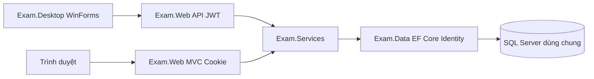

# Hợp đồng tích hợp Exam

Trạng thái: đã triển khai và kiểm tra tích hợp ngày 24/10/2026. Nguồn quyết định: DECISIONS.md; phạm vi bằng chứng: REPORT.md.

## Kiến trúc và quyền sở hữu

- A1: Exam.Core, Exam.Data, Exam.Services; Exam.Web project/Program/controllers/view-models/auth/background task. Đóng băng DTO trước, gửi A2/A3; không sửa Views/wwwroot.
- A2: chỉ Exam.Desktop, client API và giao diện WinForms.
- A3: chỉ Exam.Web/Views và Exam.Web/wwwroot, Razor/Bootstrap/JS/CSS.
- Điều phối: solution, kiểm thử, migration/script tích hợp, cấu hình chạy, báo cáo, tài liệu.

## Nguyên tắc giao tiếp

- Đăng ký: `GET/POST /Account/Register` công khai, POST có antiforgery. RegisterVm gồm UserName, FullName, StudentCode, Email, Password, ConfirmPassword, AccountType (Student/Lecturer; mặc định Student). StudentCode bắt buộc chỉ khi Student. AuthService.RegisterAsync tạo Student hoạt động và gán vai trò ngay; giảng viên tạo IsActive=false, RequestedRole theo yêu cầu, chưa có UserRoles và chưa được đăng nhập. Trường Role/Roles giả mạo không cấp quyền. Tài khoản quản trị đầu tiên của môi trường demo do seeder tạo. Quản trị viên hiện có cấp thêm tài khoản quản trị trong Desktop → Tài khoản / thí sinh. Thành công chuyển về Login với hướng dẫn phù hợp. `GET /Help` công khai hướng dẫn sử dụng.
- Duyệt nhân sự: `POST /api/admin/users/{id}/action` với `{ "action": "approve" }`, chỉ Administrator. Kiểm tra pending trong giao dịch SERIALIZABLE, cấp vai trò được đề nghị, kích hoạt, xóa RequestedRole và thu hồi phiên. Duyệt lại trả 409; unlock hồ sơ pending trả 409. User list/detail có requestedRole. Đăng nhập đúng mật khẩu khi pending trả 403 và thông báo chờ duyệt; sai mật khẩu vẫn 401 chung.

- `questions` list/detail có `version` base64; PUT sửa câu hỏi bắt buộc gửi lại `values.version` gốc, thiếu/sai/cũ trả 409. Metadata có kiểu `hidden`: client giữ token khi sửa nhưng không dựng ô nhập hoặc cột danh sách. Tạo mới không gửi phiên bản.

- JSON camelCase, enum/role dùng chuỗi. Quyền: Student, Lecturer, Administrator.
- Cookie dành cho giảng viên và thí sinh trên Web. JWT Desktop chỉ cấp cho quản trị viên. Máy chủ kiểm tra phiên và vai trò hiện tại trên mỗi yêu cầu.
- API quản trị và MVC đều gọi cùng Exam.Services; không truy cập DbContext từ Form/View/JS.
- Danh sách quản trị hỗ trợ search/page/pageSize; lọc đúng quyền trước khi phân trang.
- GET đọc dữ liệu, POST/PUT/DELETE thay đổi. Không trả IsCorrect/IsCorrectSnapshot trong DTO đang làm bài.
- Lỗi trả ProblemDetails với status/title/detail; lỗi quyền 403, chưa xác thực 401, không tìm thấy 404, dữ liệu/xung đột nghiệp vụ 400/409. Không trả exception/secret.
- Cookie mutation và Fetch gửi antiforgery token. JWT mutation không dựa vào cookie.
- Tất cả thời gian UTC ISO 8601; UI hiển thị giờ Việt Nam; hạn và quyền chỉ do server xác định.

## Chức năng bắt buộc của hợp đồng

1. Login/logout Desktop và Web, kiểm tra ứng dụng đúng vai trò, thu hồi phiên.
2. Quản trị tài khoản/thí sinh/phân công giảng viên; môn/chủ đề/câu hỏi/đề; đợt/phân công/theo dõi/công bố; xuất CSV/XLSX.
3. Student: danh sách/tìm kiếm/chi tiết đợt, bắt đầu hoặc phục hồi, lưu lựa chọn/đánh dấu, lấy giờ/trạng thái, nộp, lịch sử, kết quả theo công bố.
4. Unique(SessionID, StudentID), snapshot bất biến, từ chối lưu tại/sau hạn, nộp/chấm idempotent, kết quả duy nhất, quét quá hạn mỗi 5 giây và khi khởi động.
5. Đề/đợt sẵn sàng được khóa đúng trạng thái; hoãn đưa về nháp trước lần mở đầu; không sửa dữ liệu đã giao; không phân công giao lịch.

## DTO và route

Các route và DTO bên dưới phản ánh mã nguồn đã tích hợp. Mọi thay đổi hợp đồng cần cập nhật đồng thời client và máy chủ.

## Giao diện đã chọn

Ứng dụng thi nội bộ, không dùng bố cục landing-page quảng cáo. Nền #F4F6FA, nội dung #FFFFFF, chữ #172B4D, chính #173D7A, thành công #176747, lỗi #B42318. Font Segoe UI/system để hỗ trợ tiếng Việt và chạy offline. Khoảng cách 8/16/24px, đường viền rõ, hiệu ứng tối thiểu. Bootstrap cục bộ cho Razor; không thêm React/Tailwind. Trang thi một cột ở 360px, lưới câu xuống dưới; trạng thái lưu dùng chữ và dấu hiệu, không chỉ màu.

## Hợp đồng đã triển khai (A1)

Nguồn chữ ký: `Exam.Core/Contracts.cs`. ID người dùng/môn/chủ đề/câu hỏi gốc/đề/đợt là `int`; ID lượt/câu-phương án snapshot/phản hồi/kết quả là `long`.

### Web MVC

| Route | Kết quả |
| --- | --- |
| GET/POST `/Account/Login` | `Exam.Web.ViewModels.LoginVm`; POST form antiforgery |
| POST `/Account/Logout` | Thu hồi phiên và xóa cookie |
| GET `/`, `/Sessions?search=&status=` | `SessionListVm` |
| GET/POST `/Sessions/Join` | Nhập mã vào thi sau khi đăng nhập, tra đợt trong phạm vi quyền và chuyển tới Details |
| GET `/Sessions/Details/{id}` | `SessionDetailVm` |
| POST `/Sessions/Start/{id}` | Tạo/tiếp tục đúng lượt cũ, chuyển trang Take |
| GET `/Attempts/Take/{id}` | `AttemptVm`; đã nộp chuyển Result |
| GET `/Attempts/Status/{id}` | `AttemptStatusDto` JSON |
| POST `/Attempts/Save/{id}` | JSON `SaveAnswerRequest`, trả `AttemptStatusDto` |
| POST `/Attempts/Submit/{id}` | JSON `{ redirectUrl }` |
| GET `/Attempts/Result/{id}` | `ResultVm` |
| GET `/Attempts/History` | `HistoryVm` |

Cookie POST phải gửi form token hoặc header `RequestVerificationToken`. `Status` đợt được tính máy chủ: Draft/Scheduled/Open/Closed/Cancelled. Lượt: InProgress/Submitted. `ReviewPolicy`: ScoreOnly/Answers/CorrectAnswers. Chưa công bố: Score/CorrectCount null, Questions rỗng.

Quyền tạo lượt mới dựa trên thành viên của lớp đang hoạt động, cùng môn và đã gán cho đợt. Đợt chưa có lớp hợp lệ từ chối tạo lượt mới dù có danh sách phân công cũ. Mã vào thi dùng để tra đợt và người dùng vẫn phải đăng nhập. Lượt đã phát sinh được truy cập theo chủ sở hữu, thời hạn và chính sách công bố, kể cả sau khi thay đổi thành viên lớp. [UC19](https://docs.google.com/spreadsheets/d/10sSsgNXNt2c-S9SLn9rWQej7txwzoXuFAWfPI9gzFOc/edit#gid=899770140&range=A392%3AB401) · [FR-F03 và FR-F04](https://docs.google.com/spreadsheets/d/10sSsgNXNt2c-S9SLn9rWQej7txwzoXuFAWfPI9gzFOc/edit#gid=482467226&range=A70%3AF71)

### Desktop API

- POST `/api/auth/login` (`LoginRequest`) → `LoginResponse`; POST `/api/auth/logout` thu hồi JWT hiện tại.
- JWT Bearer của quản trị viên cho mọi `/api/admin` route.
- GET `/api/admin/catalog` → `AdminCatalogDto` theo vai trò và phạm vi.
- GET `/api/admin/{resource}?search=&page=1&pageSize=100` → `AdminPageDto`. `questions` còn nhận `subjectId`, `topicId`, `difficulty`; lọc và phân trang câu hỏi bằng SQL. Danh mục môn học nhận bộ lọc tùy chọn `isActive=true|false`.
- GET `/api/admin/{resource}/{id}` → dictionary chi tiết (chính các key field metadata).
- POST `/api/admin/{resource}` và PUT `/api/admin/{resource}/{id}` nhận `AdminSaveRequest { values: { ... } }`, trả `{ id }`.
- DELETE `/api/admin/{resource}/{id}` xóa khi chưa tham chiếu; câu hỏi đã tham chiếu chuyển ngừng sử dụng.
- POST `/api/admin/{resource}/{id}/action` nhận `{ action }`: users lock/unlock; exams ready/draft; sessions activate/postpone/cancel/publish.
- GET `/api/admin/sessions/{id}/export?format=csv|xlsx`: kiểm tra scope đợt; đủ toàn bộ kết quả, UTF-8 BOM CSV và XLSX OpenXML; không có chức năng sửa điểm.

API Desktop cung cấp users/subjects/assignments cho Administrator. Dịch vụ dùng chung giới hạn học liệu theo môn được phân công và đợt thi theo môn và người phụ trách. Trang Web giảng viên hiện hiển thị môn được phân công. `monitor` chỉ đọc; row `id` là ID phân công thí sinh, `sessionId` dành xuất kết quả.

Field types metadata: text/password/number/datetime/checkbox/select/questionpoints. questionPoints là object `{ "questionId": decimalPoints }`; editor gửi thêm questionIds là mảng key đã chọn. Backend vẫn nhận pointsPerQuestion nếu cần tương thích; điểm từng câu tối đa 2 chữ số thập phân, tổng 10 mới xác nhận Ready. Câu hỏi gồm option1..option4 và correctIndex 1..4. Người dùng chỉ chọn nhãn qua control, không nhập JSON hay ID thô.

### Cấu hình và seed

- `ConnectionStrings:ExamDb`, `Jwt:Key` (ít nhất 32 byte) cấp qua user-secrets/environment; không có secret mặc định trong source.
- Issuer mặc định Exam.Web, Audience Exam.Desktop; phiên cookie/JWT 4 giờ, kiểm tra bảng AuthSessions trên từng request.
- `Seed:Password` cấp cục bộ; lệnh `dotnet run --project Exam.Web -- --seed` chỉ được phép Development; không tự migrate/create DB. `DemoSeeder.SeedAsync(IServiceProvider,string)` tạo dữ liệu idempotent cơ bản.
- Seed usernames: admin, lecturer, lecturer2, officer, officer2, student, student2; vai trò tương ứng, môn CSHARP/DATABASE phân scope, đề 5 câu mỗi câu 2 điểm, đợt Active có 2 thí sinh.
- Background worker quét/khôi phục chấm ngay lúc khởi động và mỗi 5 giây; lỗi ghi được retry ở lần quét tiếp theo.

### Bổ sung tích hợp đã thống nhất

- `LoginRequest(UserName, Password, Role = null)`: một tài khoản có nhiều vai trò trong UserRoles; mỗi phiên Desktop chọn một vai trò hoạt động. Role=null chọn vai trò nhân sự đầu tiên; Role được chọn phải là thành viên và khác Student. Web chọn Student nếu tài khoản có vai trò này. Mọi claim phiên chứa đúng vai trò hoạt động; thay đổi vai trò thu hồi mọi phiên cũ.
- Catalog users có `roles` multiselect, GET trả roles array và role chuỗi hiển thị; ghi chấp nhận roles array hoặc role đơn để tương thích.
- POST `/api/admin/users/import`: `ImportStudentsRequest(Csv, Preview=false)`; chỉ Administrator. CSV UTF-8 (có/không BOM), header `UserName,FullName,StudentCode,Email,Password`, tối đa 500 dòng/1 MB. Hỗ trợ quoted field, dấu phẩy và xuống dòng trong trường, escape dấu nháy kép. Preview=true kiểm tra mọi dòng không ghi DB; Preview=false kiểm tra lại và nhập trong một transaction, có lỗi rollback toàn bộ, không ghi đè tài khoản cũ. UI che mật khẩu khi xem trước.
- `ExamSessions.PublishedAt` lưu giờ UTC công bố; `publishedAt` có trong row danh mục đợt thi.

### Kiểm soát phiên bản câu hỏi (UC-10.2)

`Questions.RowVersion` là SQL Server rowversion, EF đánh dấu concurrency token. List/detail câu hỏi trả `version` base64; metadata `hidden` giữ token khi mở/sửa nhưng không hiển thị. PUT câu hỏi hiện có bắt buộc gửi đúng version đã đọc; thiếu hoặc cũ trả 409, yêu cầu tải lại. Mọi lần sửa, kể cả chỉ thay phương án, đều cập nhật token của câu hỏi. Không thay đổi cách tạo câu hỏi mới. Migration bổ sung do điều phối quản lý.

UC-22: đổi môn của chủ đề đã có câu hỏi bị từ chối 409, giữ phạm vi môn cũ. UC-11.3: được hủy xác nhận đề khi mọi đợt liên quan còn Draft và chưa từng mở; đợt Active/đã mở hoặc trạng thái khác chặn thao tác. Kiểm tra và chuyển trạng thái đề nằm trong giao dịch SERIALIZABLE để không đua với kích hoạt đợt.
