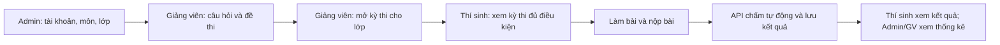
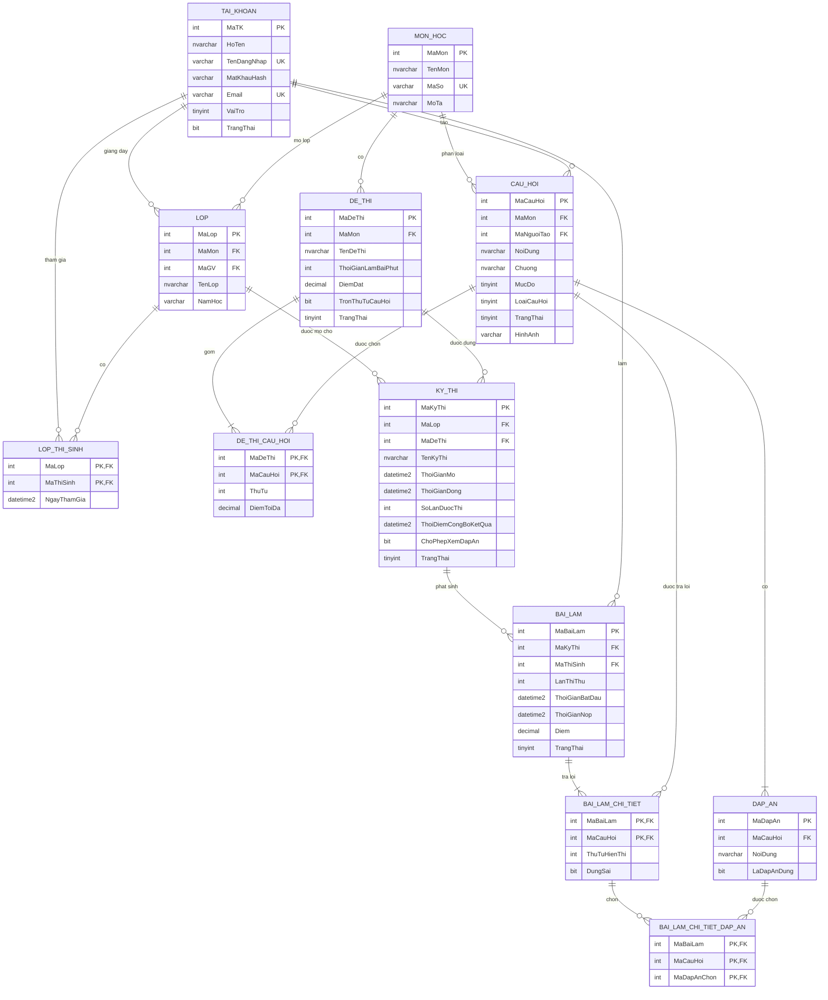
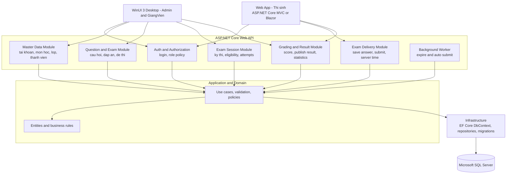
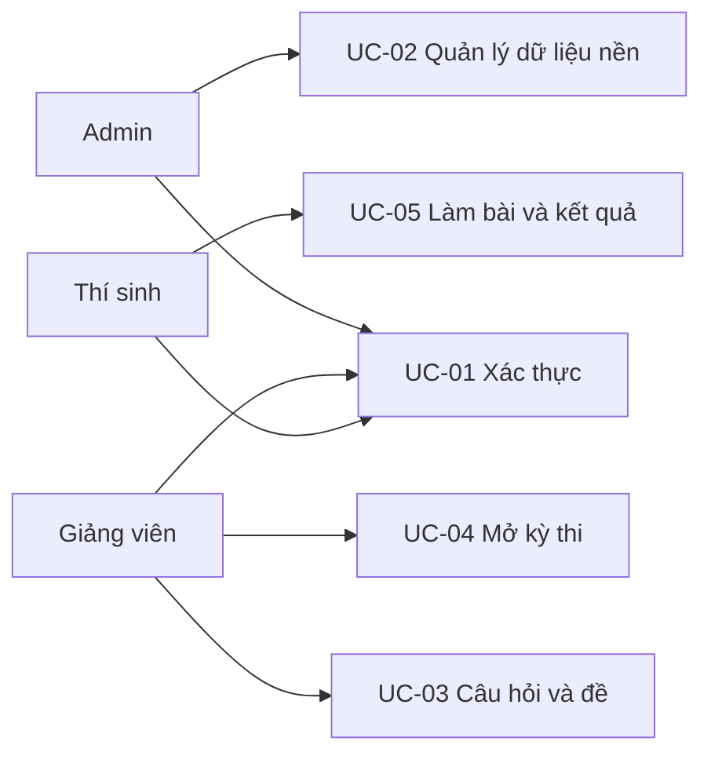
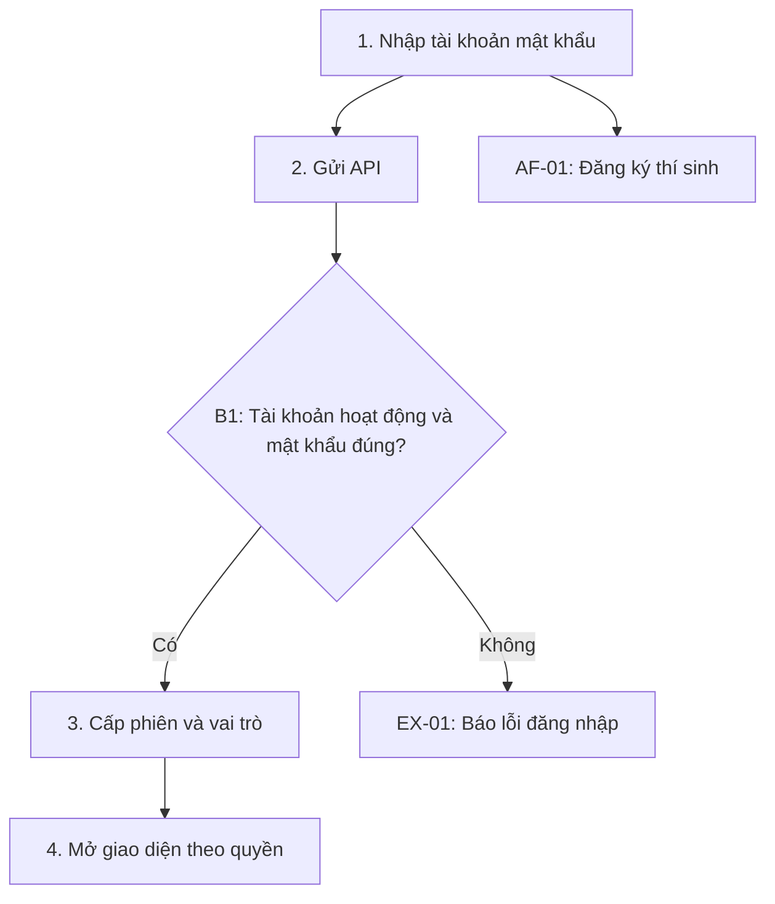
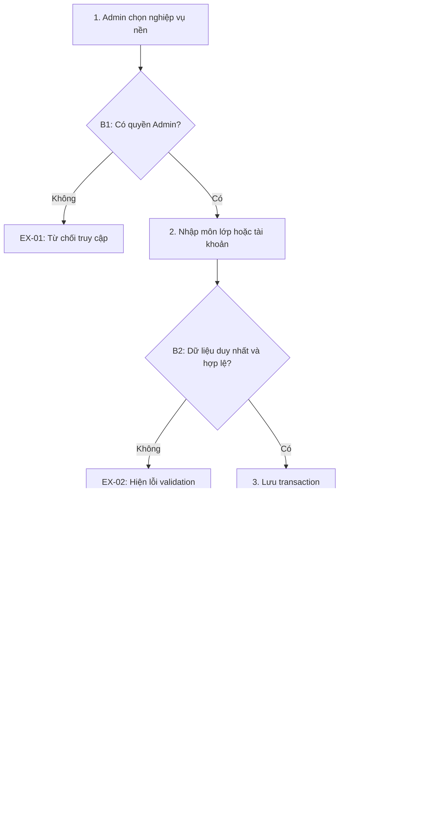
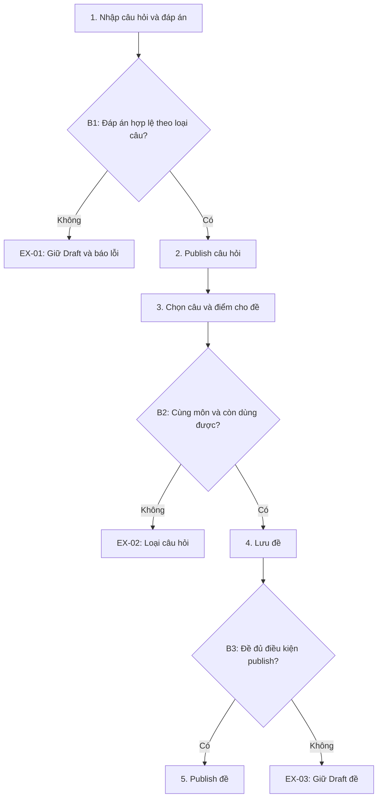
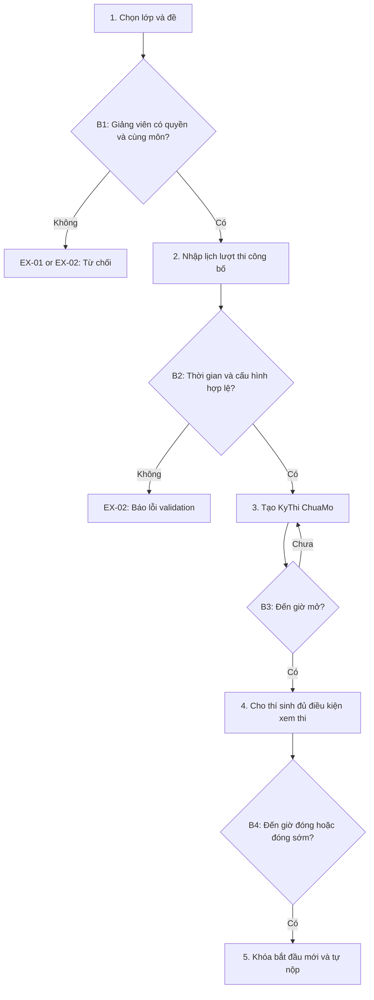
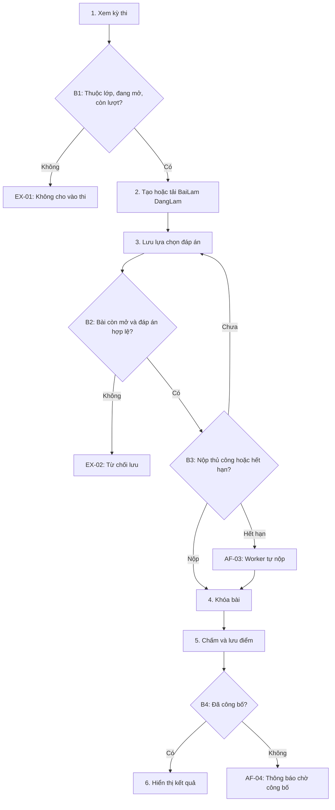

# Thiết kế MVP - Hệ thống Thi Trắc Nghiệm Trực Tuyến

> **Tài liệu thiết kế lịch sử, đã được thay thế ngày 24/10/2026.** Không dùng các vai trò, nhiều đáp án đúng, số lượt hoặc kiến trúc WinUI bên dưới làm hợp đồng triển khai. Nguồn hiện hành: `docs/YEU_CAU_DU_AN_DE_TAI_18.md`, `DECISIONS.md` và `CONTRACT.md`. Bản cũ được giữ để truy vết, không phải mô tả phần mềm hiện tại.

## 1. Quyết định phạm vi

MVP cung cấp một luồng hoàn chỉnh từ quản trị dữ liệu đến thi và xem kết quả:

Các tính năng **trong MVP**: đăng nhập/phân quyền, môn học/lớp/thành viên,
ngân hàng câu hỏi, tạo đề thủ công, mở kỳ thi theo lớp, câu hỏi một hoặc nhiều
đáp án đúng, lưu đáp án, tự nộp khi hết hạn, chấm tự động, kết quả và thống kê
cơ bản.

Các tính năng **sau MVP**: đăng ký công khai, import Excel/Word, sinh đề theo
ma trận, trộn đáp án, SignalR và xuất Excel/PDF.
Chúng không được mô tả là đã hoàn thành cho đến khi có kiểm thử thực tế.

## 2. Quy tắc kiến trúc bắt buộc

- Desktop WinUI 3 là client quản trị cho Admin/Giảng viên; Web C# là client của
  thí sinh; cả hai chỉ giao tiếp với ASP.NET Core Web API.
- API là nơi duy nhất áp dụng quy tắc nghiệp vụ và truy cập SQL Server qua EF
  Core. Desktop/Web không kết nối trực tiếp cơ sở dữ liệu.
- Cơ sở dữ liệu là **Microsoft SQL Server**, không phải PostgreSQL.
- Authentication và authorization được kiểm tra ở API cho mọi endpoint. Web
  không lưu access token lâu dài trong `localStorage`; ưu tiên cookie HttpOnly
  hoặc cơ chế token phù hợp có biện pháp chống XSS/CSRF.
- Server xác định thời gian hợp lệ, quyền dự thi, số lần thi và kết quả. Client
  chỉ hiển thị đồng hồ, không phải nguồn sự thật.

## 3. ERD SQL Server đã chỉnh

### 3.1. Các thay đổi so với sơ đồ ban đầu

1. `KyThi` giữ `MaDeThi`, không để `DeThi` giữ `MaKyThi`. Một đề mẫu có thể
   được dùng lại cho nhiều kỳ thi.
2. `BaiLam` tham chiếu `KyThi`, không cần lặp `MaDeThi`; đề thi được xác định
   qua `KyThi`.
3. `BaiLamChiTiet` đại diện câu trả lời của một câu hỏi trong một bài làm;
   `BaiLamChiTiet_DapAn` lưu từng đáp án thí sinh chọn. Quan hệ này hỗ trợ cả
   câu một và nhiều đáp án đúng mà vẫn đạt 1NF.
4. `DeThi_CauHoi` lưu `DiemToiDa` và `ThuTu`; không lưu `SoCauHoi` trong
   `DeThi` vì đó là dữ liệu suy ra từ bảng liên kết.
5. Câu hỏi có trạng thái `Draft/Published/Retired`. Câu hỏi trong đề đã có bài
   làm không được sửa nội dung hoặc đáp án; muốn sửa phải tạo câu hỏi mới.

### 3.2. Ràng buộc không được bỏ qua

| Ràng buộc                                                                               | Cách bảo đảm                                                                  |
| ----------------------------------------------------------------------------------------- | --------------------------------------------------------------------------------- |
| Tài khoản chỉ có một tên đăng nhập/email                                         | Unique index trên`TenDangNhap`, `Email`                                      |
| Thành viên lớp không trùng                                                           | Khóa chính ghép`Lop_ThiSinh(MaLop, MaThiSinh)`                               |
| Một lần thi chỉ sinh một bài làm                                                    | Unique index`BaiLam(MaKyThi, MaThiSinh, LanThiThu)`                             |
| Thí sinh thuộc lớp và chưa vượt số lần thi                                       | API kiểm tra trong transaction trước khi tạo`BaiLam`                        |
| Đề và lớp cùng môn học                                                             | API kiểm tra`DeThi.MaMon == Lop.MaMon` trước khi tạo `KyThi`              |
| Câu một đáp án chọn đúng một; câu nhiều đáp án có từ hai đáp án đúng | Validation service theo`LoaiCauHoi`                                             |
| Bài làm lịch sử không đổi nghĩa                                                   | Cấm sửa câu hỏi/đáp án đã được dùng; tạo câu hỏi phiên bản mới |
| Điểm không bị sai số nhị phân                                                      | Dùng`decimal`, không dùng `float`                                          |

## 4. Sửa báo cáo giải trình kiến trúc

| Nội dung cũ                                   | Nội dung thay thế chính xác                                                             |
| ----------------------------------------------- | ------------------------------------------------------------------------------------------- |
| PostgreSQL trong component diagram              | Microsoft SQL Server, EF Core provider`UseSqlServer`                                      |
| `Exam 1-n Question`                           | `DeThi` và `CauHoi` có quan hệ n-n qua `DeThi_CauHoi`                              |
| `Result` là thực thể chính                | `BaiLam` và `BaiLamChiTiet` lưu lần thi, lựa chọn và kết quả                    |
| Application Core chứa service có`DbContext` | Application chỉ phụ thuộc interface; Infrastructure triển khai EF Core/DbContext        |
| JWT lưu trong Local Storage                    | Web dùng cookie HttpOnly hoặc token flow được bảo vệ; API luôn kiểm tra claim/role |
| SignalR là thành phần đã có               | Chỉ ghi là hướng mở rộng, trừ khi Hub và test thực tế đã được triển khai    |
| Cloud, Docker, scale-out đã tối ưu          | Chỉ ghi là khả năng mở rộng; không tuyên bố đã triển khai                       |

## 5. Ma trận trách nhiệm client

| Chức năng                                | Desktop Admin/GV    | Web Thí sinh                     | API                                  | SQL Server            |
| ------------------------------------------ | ------------------- | --------------------------------- | ------------------------------------ | --------------------- |
| Tài khoản, môn học, lớp, thành viên | CRUD                | Xem thông tin cá nhân          | kiểm tra quyền/quy tắc            | lưu dữ liệu        |
| Câu hỏi, đáp án, đề thi             | CRUD/tạo đề      | Không truy cập đáp án đúng | validation/publish                   | lưu dữ liệu        |
| Kỳ thi và danh sách dự thi             | Tạo/mở/đóng     | Xem kỳ thi đủ điều kiện     | kiểm tra thời gian/lớp/lượt thi | lưu dữ liệu        |
| Làm bài và nộp bài                    | Theo dõi           | chọn đáp án/nộp              | lưu tạm/chấm/tự nộp             | lưu bài làm        |
| Kết quả                                  | thống kê cơ bản | xem kết quả của mình          | lọc theo quyền                     | lưu điểm/chi tiết |

## 6. Component Diagram MVP

| Component         | Trách nhiệm MVP                                                         | Không được làm                                      |
| ----------------- | ------------------------------------------------------------------------- | -------------------------------------------------------- |
| Web App           | danh sách kỳ thi, làm bài, nộp bài, xem kết quả của chính mình | tự chấm điểm hoặc tự quyết định còn lượt thi |
| Desktop App       | quản lý dữ liệu, câu hỏi, đề, kỳ thi, thống kê                 | truy cập SQL Server trực tiếp                         |
| Auth module       | xác thực và policy Admin/GiangVien/ThiSinh                             | cấp role Admin/GiangVien khi thí sinh tự đăng ký   |
| Exam Delivery     | tạo/tiếp tục bài làm, lưu đáp án, xác nhận hạn nộp           | tin thời gian do client gửi lên                       |
| Background Worker | tự nộp bài quá hạn chưa nộp                                        | thay thế validation khi người dùng nộp thủ công   |
| Infrastructure    | EF Core, migration, SQL Server                                            | chứa quy tắc nghiệp vụ giao diện                    |

## 7. Use case detail - nguồn triển khai chính

Trong mỗi activity diagram, `B1`, `B2`... là điểm rẽ nhánh. Mỗi `AF` hoặc `EX`
trong use case bên trên phải tham chiếu đúng điểm rẽ nhánh đó; không thêm nhánh
nghiệp vụ không được mô tả trong bảng luồng.

### UC-01 - Đăng nhập và phân quyền

- **UC_id:** UC-01
- **UC_name:** Đăng nhập và phân quyền
- **Summary:** Người dùng đăng nhập vào client phù hợp; API xác thực và cấp
  quyền theo vai trò.

| Bước | Actor action                                           | System response                                                                     |
| -----: | ------------------------------------------------------ | ----------------------------------------------------------------------------------- |
|      1 | Người dùng mở màn hình đăng nhập.             | Client hiển thị biểu mẫu tên đăng nhập và mật khẩu.                      |
|      2 | Người dùng nhập thông tin và chọn Đăng nhập. | Client gửi yêu cầu an toàn đến API.                                           |
|      3 | -                                                      | API tìm tài khoản đang hoạt động và so khớp password hash.                 |
|      4 | -                                                      | API tạo phiên/token có`MaTK` và `VaiTro`, rồi trả thông tin tối thiểu. |
|      5 | Người dùng tiếp tục sử dụng hệ thống.         | Client hiển thị chức năng đúng vai trò; mọi API sau vẫn kiểm tra policy.  |

**Alternative path**

- **AF-01 (trước B1):** Thí sinh chọn đăng ký. Hệ thống tạo tài khoản có vai
  trò cố định `ThiSinh`, trạng thái hoạt động theo chính sách; không cho chọn
  Admin/Giảng viên.
- **AF-02 (sau B1-Có):** Token hết hạn. Client yêu cầu đăng nhập lại hoặc thực
  hiện refresh flow đã được bảo vệ.

**Exception path**

- **EX-01 (B1-Không):** Tài khoản không tồn tại, bị khóa hoặc mật khẩu sai.
  API trả lỗi đăng nhập chung, ghi log an toàn và không tiết lộ nguyên nhân.

### UC-02 - Quản lý dữ liệu nền

- **UC_id:** UC-02
- **UC_name:** Quản lý tài khoản, môn học, lớp và thành viên
- **Summary:** Admin duy trì dữ liệu nền để Giảng viên mở kỳ thi và Thí sinh có
  tư cách dự thi.

| Bước | Actor action                                                    | System response                                                             |
| -----: | --------------------------------------------------------------- | --------------------------------------------------------------------------- |
|      1 | Admin mở Desktop và chọn một màn hình quản lý.          | API xác nhận policy`Admin`.                                             |
|      2 | Admin tạo/sửa môn học hoặc tạo lớp cho một môn.        | API kiểm tra mã duy nhất và lưu transaction.                           |
|      3 | Admin tạo/cập nhật tài khoản Giảng viên hoặc Thí sinh. | API hash mật khẩu, gán vai trò hợp lệ và lưu tài khoản.           |
|      4 | Admin gán Giảng viên cho lớp và thêm Thí sinh vào lớp. | API kiểm tra vai trò, tránh trùng thành viên và lưu`Lop_ThiSinh`. |
|      5 | Admin xem danh sách sau cập nhật.                            | Client tải lại dữ liệu đã được API lọc theo quyền.               |

**Alternative path**

- **AF-01 (sau B2-Có):** Admin cập nhật dữ liệu nền đã có. Hệ thống chỉ cho
  thay đổi khi không phá vỡ tham chiếu kỳ thi/bài làm.
- **AF-02 (sau B2-Có):** Admin vô hiệu hóa thay vì xóa tài khoản đã có dữ liệu
  lịch sử.

**Exception path**

- **EX-01 (B1-Không):** Người dùng không có quyền Admin: API từ chối truy cập.
- **EX-02 (B2-Không):** Mã môn hoặc tên đăng nhập/email trùng: API từ chối.
- **EX-03 (B3-Không):** Tài khoản không phải Thí sinh hoặc đã là thành viên lớp:
  API từ chối, không tạo dữ liệu trùng.

### UC-03 - Quản lý câu hỏi và tạo đề

- **UC_id:** UC-03
- **UC_name:** Quản lý ngân hàng câu hỏi và tạo đề thi
- **Summary:** Giảng viên tạo câu hỏi, đáp án, publish câu hỏi hợp lệ và lắp đề
  thi thủ công với thứ tự, điểm từng câu.

| Bước | Actor action                                                           | System response                                                                                                          |
| -----: | ---------------------------------------------------------------------- | ------------------------------------------------------------------------------------------------------------------------ |
|      1 | Giảng viên chọn môn học mình phụ trách.                        | API kiểm tra quyền quản lý môn/lớp tương ứng.                                                                   |
|      2 | Giảng viên nhập nội dung câu hỏi, loại câu hỏi và đáp án. | API kiểm tra nội dung, đáp án và loại câu hỏi.                                                                  |
|      3 | Giảng viên yêu cầu publish câu hỏi.                              | API xác nhận câu một đáp án có đúng một đáp án đúng; câu nhiều đáp án có từ hai đáp án đúng. |
|      4 | Giảng viên tạo đề và chọn các câu hỏi đã publish.          | API chỉ chấp nhận câu cùng môn, lưu`DeThi_CauHoi`, thứ tự và điểm tối đa.                                |
|      5 | Giảng viên xác nhận đề.                                          | API kiểm tra đề có ít nhất một câu và chuyển trạng thái`Published`.                                        |

**Alternative path**

- **AF-01 (B1-Không):** Giảng viên lưu `Draft`; câu hỏi chưa được dùng trong
  đề/kỳ thi.
- **AF-02 (sau B2-Có):** Giảng viên thay đổi thứ tự hoặc điểm từng câu trước
  khi publish đề.

**Exception path**

- **EX-01 (B1-Không):** Số đáp án đúng không tương ứng loại câu hỏi: API
  giữ `Draft` và trả thông báo validation.
- **EX-02 (B2-Không):** Câu hỏi thuộc môn khác hoặc đã bị `Retired`: API từ
  chối thêm vào đề.
- **EX-03 (B3-Không):** Đề rỗng hoặc tổng điểm không đúng chính sách: API
  không publish.

### UC-04 - Tạo và mở kỳ thi

- **UC_id:** UC-04
- **UC_name:** Tạo kỳ thi cho lớp
- **Summary:** Giảng viên gán đề đã publish cho lớp cùng môn, cấu hình thời gian,
  lượt thi và chính sách công bố kết quả.

| Bước | Actor action                                                                        | System response                                                                               |
| -----: | ----------------------------------------------------------------------------------- | --------------------------------------------------------------------------------------------- |
|      1 | Giảng viên chọn lớp phụ trách.                                                | API kiểm tra quyền Giảng viên đối với lớp.                                            |
|      2 | Giảng viên chọn đề, thời gian mở/đóng, lượt thi và công bố kết quả. | API kiểm tra môn của lớp/đề, tính hợp lệ thời gian và giá trị cấu hình.        |
|      3 | Giảng viên xác nhận tạo kỳ thi.                                               | API lưu`KyThi` ở trạng thái `ChuaMo`.                                                 |
|      4 | Đến thời gian mở theo server.                                                   | API trả kỳ thi vào danh sách đủ điều kiện của các Thí sinh trong lớp.            |
|      5 | Đến thời gian đóng hoặc Giảng viên đóng sớm.                             | API ngăn bắt đầu mới và kích hoạt xử lý bài đang làm theo chính sách tự nộp. |

**Alternative path**

- **AF-01 (sau B2-Có):** Giảng viên cập nhật kỳ thi khi chưa có bài làm.
- **AF-02 (B4-Có):** Giảng viên đóng sớm; background worker tự nộp các
  bài đang làm theo thời điểm đóng đã cập nhật.

**Exception path**

- **EX-01 (B1-Không):** Giảng viên không phụ trách lớp: API trả `403`.
- **EX-02 (B1-Không hoặc B2-Không):** Lớp và đề khác môn, thời gian đóng không sau mở, hoặc
  số lượt nhỏ hơn một: API từ chối lưu.

### UC-05 - Làm bài, nộp bài và xem kết quả

- **UC_id:** UC-05
- **UC_name:** Làm bài, nộp bài, chấm và xem kết quả
- **Summary:** Thí sinh thực hiện bài thi hợp lệ; server lưu câu trả lời, tự nộp
  đúng hạn, chấm theo đáp án và chỉ công bố kết quả khi cấu hình cho phép.

| Bước | Actor action                               | System response                                                                                            |
| -----: | ------------------------------------------ | ---------------------------------------------------------------------------------------------------------- |
|      1 | Thí sinh mở danh sách kỳ thi.          | API chỉ trả kỳ thi thuộc lớp, đang mở và còn lượt.                                              |
|      2 | Thí sinh chọn Bắt đầu.                | API kiểm tra lại điều kiện trong transaction, tạo`BaiLam` và thứ tự hiển thị.                 |
|      3 | Thí sinh chọn hoặc bỏ chọn đáp án. | API kiểm tra đáp án thuộc câu hỏi của bài, cập nhật`BaiLamChiTiet` và bảng đáp án chọn. |
|      4 | Thí sinh chọn Nộp bài.                 | API kiểm tra hạn nộp theo server, khóa bài và bắt đầu chấm.                                      |
|      5 | -                                          | API so khớp tập đáp án chọn với tập đáp án đúng, tính điểm`decimal`, lưu kết quả.     |
|      6 | Thí sinh mở kết quả.                   | API chỉ trả bài làm của chính thí sinh và chỉ khi kỳ thi đã công bố.                         |

**Alternative path**

- **AF-01 (sau B1-Có):** Thí sinh đã có bài `DangLam`; API trả bài làm hiện có
  và thời gian còn lại thay vì tạo lượt mới.
- **AF-02 (sau B2-Có):** Thí sinh mất kết nối rồi vào lại trước hạn; client tải
  đáp án đã lưu từ API.
- **AF-03 (B3-Hết hạn):** Background worker phát hiện quá hạn và tự gọi quy
  tắc khóa/chấm giống nộp bài thủ công.

**Exception path**

- **AF-04 (B4-Không):** Kỳ thi chưa công bố kết quả; Web thông báo chờ công bố.
- **EX-01 (B1-Không):** Thí sinh không thuộc lớp, kỳ thi chưa mở/đã đóng hoặc
  hết lượt: API không tạo bài làm.
- **EX-02 (B2-Không):** Bài đã nộp/hết hạn hoặc đáp án không thuộc câu hỏi của
  đề: API từ chối thay đổi.
- **EX-03 (sau B3-Nộp):** Hai yêu cầu nộp đồng thời: transaction chỉ chấp nhận
  yêu cầu đầu tiên; yêu cầu còn lại nhận bài đã nộp.

## 8. Thứ tự triển khai skeleton

1. Tạo ASP.NET Core Web API, Domain/Application/Infrastructure và migration
   SQL Server theo ERD trên.
2. Tạo seed Admin, MonHoc, GiangVien, Lop và ThiSinh; chứng minh Desktop/API
   dùng cùng database.
3. Hoàn thành UC-01 đến UC-04 trên Desktop/API trước.
4. Hoàn thành UC-05 trên Web/API, sau đó kiểm thử luồng xuyên suốt.
5. Chỉ sau đó mới thêm import, ma trận, SignalR và export báo cáo.
