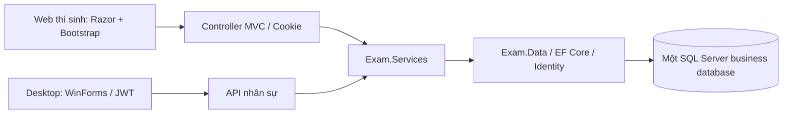
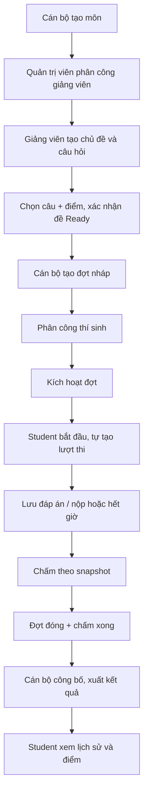

# Báo cáo tổng hợp demo hệ thống quản lý thi trắc nghiệm

**Ngày:** 24/10/2026, múi giờ Việt Nam (UTC+7).  
**Sản phẩm:** WinForms cho nhân sự + ASP.NET Core MVC/Razor/Bootstrap cho thí sinh + SQL Server dùng chung.  
**Phạm vi báo cáo:** các chức năng đã thực hiện/kiểm tra trong buổi làm việc, thao tác vận hành đã hướng dẫn, dữ liệu sau khi làm sạch và đợt cải tiến giao diện Desktop. Đây là báo cáo kỹ thuật buổi demo; chưa thay thế toàn bộ báo cáo môn học có bìa, mục lục, khảo sát và đóng góp thành viên.

## 1. Kết quả chính

- Đã dựng sáu project C#, tích hợp hai client dùng chung nghiệp vụ và SQL Server.
- Đã thực hiện các luồng tài khoản, đăng ký/duyệt nhân sự, ngân hàng câu hỏi, đề, đợt thi, phân công, làm bài, chấm, công bố và xuất kết quả.
- Đã xử lý lỗi danh mục chủ đề cũ và chống ghi đè câu hỏi từ form cũ.
- Theo yêu cầu người dùng, đã xóa dữ liệu demo/kiểm thử trước đó, giữ bốn tài khoản đại diện; sau đó bổ sung 60 câu Toán vào hai chủ đề do người dùng tạo.
- Desktop được đổi sang hướng học thuật, Theme/control chung, UserControl theo chức năng và Presenter; dữ liệu và API nghiệp vụ được giữ nguyên.
- Bằng chứng kiểm tra được tách rõ: build, xUnit/SQL, HTTP, trình duyệt, render Desktop offscreen và đo tải loopback.

Các số đo/kiểm tra HTTP ở giai đoạn trước là bằng chứng của phiên chạy đã ghi trong artifact, không có nghĩa mọi dữ liệu kiểm thử vẫn còn sau bước làm sạch. Không chạy lại script sinh dữ liệu vào DB đang demo chỉ để tạo báo cáo này.

## 2. Kiến trúc và vị trí mã nguồn



| Thành phần | Trách nhiệm | Mã nguồn tham chiếu |
|---|---|---|
| Exam.Core | DTO dùng chung, hợp đồng request/response | [Contracts.cs](../Exam.Core/Contracts.cs) |
| Exam.Data | Entity, ánh xạ Identity, FK/UQ/CHECK, migrations | [Exam.Data/ExamDbContext.cs:12](<E:/Project/LapTrinh_CSharp_2026-2027/Exam Management Application/Exam.Data/ExamDbContext.cs:12>); [Exam.Data/Entities.cs:4](<E:/Project/LapTrinh_CSharp_2026-2027/Exam Management Application/Exam.Data/Entities.cs:4>) |
| Exam.Services | Quyền/phạm vi, validation, giao dịch, tổ chức và chấm thi | [Exam.Services/AdminService.cs:167](<E:/Project/LapTrinh_CSharp_2026-2027/Exam Management Application/Exam.Services/AdminService.cs:167>); [Exam.Services/ExamService.cs:31](<E:/Project/LapTrinh_CSharp_2026-2027/Exam Management Application/Exam.Services/ExamService.cs:31>) |
| Exam.Web | MVC cho thí sinh, API cho nhân sự, xác thực và worker hết giờ | [Exam.Web/Program.cs:10](<E:/Project/LapTrinh_CSharp_2026-2027/Exam Management Application/Exam.Web/Program.cs:10>); [Exam.Web/Controllers/ApiControllers.cs:17](<E:/Project/LapTrinh_CSharp_2026-2027/Exam Management Application/Exam.Web/Controllers/ApiControllers.cs:17>); [Exam.Web/Program.cs:49](<E:/Project/LapTrinh_CSharp_2026-2027/Exam Management Application/Exam.Web/Program.cs:49>) |
| Exam.Desktop | Shell, navigation, UserControl/Presenter và client HTTP | [Exam.Desktop/MainForm.cs:7](<E:/Project/LapTrinh_CSharp_2026-2027/Exam Management Application/Exam.Desktop/MainForm.cs:7>); [Exam.Desktop/NavigationService.cs:4](<E:/Project/LapTrinh_CSharp_2026-2027/Exam Management Application/Exam.Desktop/NavigationService.cs:4>); [Exam.Desktop/Presenters/ResourcePresenter.cs:24](<E:/Project/LapTrinh_CSharp_2026-2027/Exam Management Application/Exam.Desktop/Presenters/ResourcePresenter.cs:24>); [Exam.Desktop/ExamApiClient.cs:10](<E:/Project/LapTrinh_CSharp_2026-2027/Exam Management Application/Exam.Desktop/ExamApiClient.cs:10>) |
| Exam.Tests | Quy tắc và ca SQL Server cách ly | [Exam.Tests/SqlExamTests.cs:89](<E:/Project/LapTrinh_CSharp_2026-2027/Exam Management Application/Exam.Tests/SqlExamTests.cs:89>) |

`App1` WinUI cũ được giữ để tham khảo, không bị xóa và không thuộc solution sản phẩm WinForms mới. Nghiệp vụ không được sao chép thành một hệ thống riêng cho Desktop. Cấu hình cục bộ/khóa ký/mật khẩu không được đưa vào mã nguồn.

## 3. Chức năng đã thực hiện và cách hoạt động

| Chức năng | Cách hoạt động / điều kiện chính | Vị trí code |
|---|---|---|
| Đăng nhập và đăng xuất | Web dùng Cookie cho Student; Desktop dùng JWT cho nhân sự, mỗi phiên chọn một vai trò đã cấp. Phiên được kiểm tra/thu hồi ở máy chủ | [Exam.Services/AuthService.cs:62](<E:/Project/LapTrinh_CSharp_2026-2027/Exam Management Application/Exam.Services/AuthService.cs:62>); [Exam.Services/AuthService.cs:84](<E:/Project/LapTrinh_CSharp_2026-2027/Exam Management Application/Exam.Services/AuthService.cs:84>); [Exam.Web/Controllers/StudentControllers.cs:10](<E:/Project/LapTrinh_CSharp_2026-2027/Exam Management Application/Exam.Web/Controllers/StudentControllers.cs:10>); [Exam.Desktop/LoginForm.cs:7](<E:/Project/LapTrinh_CSharp_2026-2027/Exam Management Application/Exam.Desktop/LoginForm.cs:7>) |
| Identity dùng chung | `Users`, `Roles`, `UserRoles` với int UserID/RoleID; không có bảng người dùng nghiệp vụ thứ hai | [Exam.Data/ExamDbContext.cs:12](<E:/Project/LapTrinh_CSharp_2026-2027/Exam Management Application/Exam.Data/ExamDbContext.cs:12>) |
| Đăng ký bốn loại tài khoản | Tên đăng nhập, họ tên, email, mật khẩu/xác nhận; mã thí sinh chỉ bắt buộc với Student. Nhân sự chờ duyệt, chưa có quyền hoạt động | [Exam.Services/AuthService.cs:12](<E:/Project/LapTrinh_CSharp_2026-2027/Exam Management Application/Exam.Services/AuthService.cs:12>); [RegisterVm](../Exam.Web/ViewModels/RegisterVm.cs) |
| Duyệt nhân sự | Administrator duyệt yêu cầu trên Desktop; cấp đúng vai trò, kích hoạt và xóa RequestedRole trong giao dịch. Mở khóa không thay cho duyệt | [Exam.Services/AdminService.cs:387](<E:/Project/LapTrinh_CSharp_2026-2027/Exam Management Application/Exam.Services/AdminService.cs:387>) |
| Môn, chủ đề, phân công giảng viên | Cán bộ quản lý môn; quản trị viên phân công giảng viên; giảng viên chỉ thao tác môn được giao | [Exam.Services/AdminService.cs:34](<E:/Project/LapTrinh_CSharp_2026-2027/Exam Management Application/Exam.Services/AdminService.cs:34>); [Exam.Services/AdminService.cs:167](<E:/Project/LapTrinh_CSharp_2026-2027/Exam Management Application/Exam.Services/AdminService.cs:167>) |
| Ngân hàng câu hỏi | Nội dung, chủ đề, độ khó, bốn phương án, một đáp án đúng. Câu đã dùng có giới hạn sửa/xóa để bảo toàn lịch sử | [Exam.Services/AdminService.cs:167](<E:/Project/LapTrinh_CSharp_2026-2027/Exam Management Application/Exam.Services/AdminService.cs:167>); [Exam.Desktop/ResourceEditorForm.cs:7](<E:/Project/LapTrinh_CSharp_2026-2027/Exam Management Application/Exam.Desktop/ResourceEditorForm.cs:7>) |
| Chống sửa dữ liệu cũ | SQL rowversion của Questions; Form gửi lại version gốc. Thiếu/sai/cũ trả 409, kể cả sửa riêng phương án | [QuestionConcurrency migration](../Exam.Data/Migrations/20261024095847_QuestionConcurrency.cs); [Exam.Services/AdminService.cs:167](<E:/Project/LapTrinh_CSharp_2026-2027/Exam Management Application/Exam.Services/AdminService.cs:167>) |
| Tải lại danh mục chủ đề | Mỗi màn tải catalog mới; Làm mới cập nhật lookup và giữ bộ lọc còn hợp lệ. Preview bỏ qua phản hồi cũ khi đổi câu nhanh | [Exam.Desktop/Presenters/ResourcePresenter.cs:24](<E:/Project/LapTrinh_CSharp_2026-2027/Exam Management Application/Exam.Desktop/Presenters/ResourcePresenter.cs:24>); [Exam.Desktop/Views/ResourceView.cs:9](<E:/Project/LapTrinh_CSharp_2026-2027/Exam Management Application/Exam.Desktop/Views/ResourceView.cs:9>) |
| Soạn đề và điểm | Chọn câu hợp lệ cùng môn, điểm từng câu dương/tối đa hai chữ số thập phân; tổng 10 để xác nhận Ready | [Exam.Services/AdminService.cs:167](<E:/Project/LapTrinh_CSharp_2026-2027/Exam Management Application/Exam.Services/AdminService.cs:167>); [Exam.Desktop/QuestionPointsPicker.cs:8](<E:/Project/LapTrinh_CSharp_2026-2027/Exam Management Application/Exam.Desktop/QuestionPointsPicker.cs:8>) |
| Đợt thi | Chọn đề Ready, lịch, thời lượng, trộn câu/phương án, chính sách xem kết quả. Kích hoạt khóa cấu hình | [Exam.Services/AdminService.cs:167](<E:/Project/LapTrinh_CSharp_2026-2027/Exam Management Application/Exam.Services/AdminService.cs:167>); [Exam.Services/AdminService.cs:387](<E:/Project/LapTrinh_CSharp_2026-2027/Exam Management Application/Exam.Services/AdminService.cs:387>); [Exam.Desktop/ResourceEditorForm.cs:247](<E:/Project/LapTrinh_CSharp_2026-2027/Exam Management Application/Exam.Desktop/ResourceEditorForm.cs:247>) |
| Phân công thí sinh | Một bản ghi xác định thí sinh được tham gia một đợt. Kiểm tra trùng và giao lịch; thí sinh tự đăng ký chưa tự có lịch | [Exam.Services/AdminService.cs:167](<E:/Project/LapTrinh_CSharp_2026-2027/Exam Management Application/Exam.Services/AdminService.cs:167>) |
| Bắt đầu lượt thi | Thí sinh bấm Bắt đầu khi có phân công và đợt mở; tạo đúng một lượt hoặc tiếp tục lượt cũ. Snapshot giữ nội dung/đáp án/điểm/thứ tự | [Exam.Services/ExamService.cs:31](<E:/Project/LapTrinh_CSharp_2026-2027/Exam Management Application/Exam.Services/ExamService.cs:31>) |
| Lưu và khôi phục bài | Autosave từng lựa chọn/đánh dấu, kiểm tra sở hữu và phương án thuộc câu; trả lỗi khi hết hạn/đã nộp. Web có trạng thái lưu và thử lại | [Exam.Services/ExamService.cs:53](<E:/Project/LapTrinh_CSharp_2026-2027/Exam Management Application/Exam.Services/ExamService.cs:53>); [attempt.js](../Exam.Web/wwwroot/js/attempt.js) |
| Thời hạn và chấm | Deadline là min(bắt đầu + thời lượng, giờ đóng đợt). Chấm theo snapshot, sai/bỏ trống 0, nộp lặp không tạo kết quả khác | [Exam.Services/ExamRules.cs:4](<E:/Project/LapTrinh_CSharp_2026-2027/Exam Management Application/Exam.Services/ExamRules.cs:4>); [Exam.Services/ExamService.cs:56](<E:/Project/LapTrinh_CSharp_2026-2027/Exam Management Application/Exam.Services/ExamService.cs:56>); [Exam.Services/ExamService.cs:67](<E:/Project/LapTrinh_CSharp_2026-2027/Exam Management Application/Exam.Services/ExamService.cs:67>) |
| Tự kết thúc khi đóng trình duyệt | Worker quét mỗi 5 giây, kể cả lúc khởi động. Không dựa vào đồng hồ/trình duyệt thí sinh để quyết định hạn | [Exam.Web/Program.cs:49](<E:/Project/LapTrinh_CSharp_2026-2027/Exam Management Application/Exam.Web/Program.cs:49>) |
| Công bố và xem lại | Cán bộ chỉ công bố khi đợt đóng và mọi lượt phát sinh có kết quả. Student chỉ thấy điểm sau công bố; bài/đáp án theo policy | [Exam.Services/AdminService.cs:387](<E:/Project/LapTrinh_CSharp_2026-2027/Exam Management Application/Exam.Services/AdminService.cs:387>); [Exam.Services/ExamService.cs:68](<E:/Project/LapTrinh_CSharp_2026-2027/Exam Management Application/Exam.Services/ExamService.cs:68>) |
| Theo dõi và tổng quan | Dữ liệu theo phạm vi; phân biệt chưa thi với điểm 0. Desktop tổng hợp số liệu hiển thị và polling theo dõi 15 giây | [Exam.Desktop/Presenters/DashboardPresenter.cs:13](<E:/Project/LapTrinh_CSharp_2026-2027/Exam Management Application/Exam.Desktop/Presenters/DashboardPresenter.cs:13>); [Exam.Desktop/Presenters/ResourcePresenter.cs:24](<E:/Project/LapTrinh_CSharp_2026-2027/Exam Management Application/Exam.Desktop/Presenters/ResourcePresenter.cs:24>) |
| Nhập thí sinh CSV | Xem trước, kiểm tra cả batch, tối đa 500 dòng/1 MB, không ghi đè tài khoản cũ và không nhập một phần | [Exam.Services/AdminService.cs:526](<E:/Project/LapTrinh_CSharp_2026-2027/Exam Management Application/Exam.Services/AdminService.cs:526>); [Exam.Services/CsvStudents.cs:10](<E:/Project/LapTrinh_CSharp_2026-2027/Exam Management Application/Exam.Services/CsvStudents.cs:10>); [ImportStudentsForm](../Exam.Desktop/ImportStudentsForm.cs) |
| Xuất kết quả | CSV UTF-8 BOM hoặc XLSX OpenXML, kiểm quyền đợt, lấy đủ trang; xử lý chuỗi có thể thành công thức CSV | [Exam.Services/ExportService.cs:9](<E:/Project/LapTrinh_CSharp_2026-2027/Exam Management Application/Exam.Services/ExportService.cs:9>) |
| Hướng dẫn trong ứng dụng | Web có Help trước/sau đăng nhập; Desktop có hướng dẫn theo vai trò và liên kết đăng ký | [Help Web](../Exam.Web/Views/Help/Index.cshtml); [Help Desktop](../Exam.Desktop/HelpForm.cs) |

### Luồng vận hành đã thống nhất



**Đợt thi** là lịch tổ chức chung; **lượt thi** là bài làm của từng thí sinh trong đợt, tự tạo lúc bắt đầu. Cột mã ở danh sách phân công là mã bản ghi phân công, không đồng nghĩa mã thí sinh. `student` là tên đăng nhập mẫu, không phải tên một người cụ thể.

## 4. Cải tiến Desktop theo phong cách giáo dục

Bản thiết kế đã được người dùng xác nhận trước khi triển khai: [DESKTOP_UI_DESIGN.md](DESKTOP_UI_DESIGN.md).

| Hạng mục | Hiện thực |
|---|---|
| Nhận diện | Xanh học thuật `#1E4E8C`, xanh ngọc `#2A9D8F`, nền sáng, Segoe UI, minh họa sách/đề thi bằng GDI+ và icon Windows |
| Đăng nhập | Hai cột thương hiệu/form, hiện/ẩn mật khẩu, cấu hình máy chủ, hướng dẫn/đăng ký, lỗi rõ ràng |
| Khung ứng dụng | Sidebar theo vai trò, thu gọn, header người dùng và tìm kiếm; NavigationService quản lý workspace |
| Tổng quan | Số liệu thật theo quyền; danh sách gần đây, quy trình tiếp theo, biểu đồ điểm từ dữ liệu đã chấm; lỗi tải không giả thành số 0 |
| Danh sách và ngân hàng | Header/bảng nhẹ, badge có chữ và màu, tìm/lọc/phân trang, preview câu hỏi, loading/rỗng/lỗi |
| Biểu mẫu | Card theo nhóm, phương án 2×2, thanh lưu/đóng cố định, Ctrl+Enter, giữ token phiên bản và quy tắc mật khẩu |
| Đợt thi | Wizard 3 bước: thông tin/đề → lịch/cấu hình → xem lại/lưu nháp; phân công và kích hoạt là thao tác tiếp theo |
| Theo dõi | Làm mới theo chu kỳ 15 giây, chống gọi chồng và dừng timer khi đóng màn; chưa phải push thời gian thực hoặc phát hiện mất mạng |
| Phản hồi | Toast thành công/lỗi, dialog xác nhận riêng; grid double buffering; Ctrl+N, Ctrl+F, F5 và Esc |

Theme và các control: [Theme.cs](../Exam.Desktop/Theme.cs), [Exam.Desktop/Controls/Primitives.cs:75](<E:/Project/LapTrinh_CSharp_2026-2027/Exam Management Application/Exam.Desktop/Controls/Primitives.cs:75>), [Exam.Desktop/Controls/Feedback.cs:29](<E:/Project/LapTrinh_CSharp_2026-2027/Exam Management Application/Exam.Desktop/Controls/Feedback.cs:29>). Kiểm tra tương phản trắng/Primary khoảng 8.32:1; không dùng chữ trắng nhỏ trực tiếp trên accent xanh ngọc có tương phản thấp. Các thay đổi hiển thị không mở rộng quyền API hay thay dữ liệu.

Đợt sửa cuối xử lý nền vuông xanh/đen lộ ngoài góc bo của nút và thay khung focus vuông bằng nét bo góc. Đã render bốn loại nút qua năm trạng thái (20 trường hợp), kiểm tra cả bốn điểm góc khớp nền cha kể cả nút mặc định AcceptButton. Ảnh: [button-states.png](../artifacts/desktop-redesign/button-states.png). Mã nút dùng chung tại [Primitives.cs](../Exam.Desktop/Controls/Primitives.cs); thanh điều hướng tại [MainForm.cs](../Exam.Desktop/MainForm.cs).

**Bằng chứng Desktop mới:** [QA](../artifacts/desktop-redesign/qa.md), [Danh sách ảnh và kích thước](../artifacts/desktop-redesign/captures.json). Đây là render Form thật bằng DrawToBitmap trên Windows, gọi API thật theo ba vai trò. DPI thực tế và các trường hợp mô phỏng được ghi trong QA; mô phỏng 150% không được tính là kiểm thử native 150%. Chưa thay thế việc người dùng click/resize/Tab trên cửa sổ Windows thực tế.

## 5. Dữ liệu sau các thao tác demo

Trong buổi làm việc có nhiều tài khoản/đợt mang tên HTTP và kiểm thử tải được tạo để xác minh chức năng. Theo yêu cầu người dùng, đã sao lưu và xóa toàn bộ dữ liệu nghiệp vụ cùng các tài khoản đó, chỉ giữ:

| Tài khoản | Vai trò | Nơi sử dụng |
|---|---|---|
| `admin` | Administrator | Desktop |
| `lecturer` | Lecturer | Desktop |
| `officer` | ExamOfficer | Desktop |
| `student` | Student | Web |

Mật khẩu bốn tài khoản được giữ nguyên. Phiên đăng nhập cũ được thu hồi. Backup trước khi làm sạch nằm tại `.local/backups/ExamAppDb-before-clean-20261024-123114.bak`; thời gian trong tên tệp này là UTC. Đây là đường dẫn cục bộ, không phải tệp cần đưa lên Git.

Sau đó đã thêm **30 câu đại số lớp 10** vào `Toán số 10`, **30 câu hình học lớp 10** vào `Toán hình`, thuộc môn `Toán`, tác giả `lecturer`. Mỗi câu có 4 phương án và 1 đáp án đúng; đã đối chiếu đủ 60 nội dung/240 phương án qua API. Có mức độ Easy/Medium/Hard và lời giải ngắn trong tệp biên soạn. Câu hỏi dùng để thi thử, không được giới thiệu là trích ngân hàng đề thi chính thức.

Nguồn đối chiếu: [JSON 60 câu](data/toan-lop-10-60-cau.json), [bản đọc có đáp án/lời giải](data/toan-lop-10-60-cau.md), [kết quả nhập](data/toan-lop-10-import-result.json). Tệp chứa đáp án chỉ dành cho người biên soạn/quản trị, không phát cho thí sinh trước giờ thi.

Tại lần đọc SQL trong lượt hoàn thiện UI: **4 users, 2 topics, 60 questions, 1 exam, 1 exam session, 1 attempt, 1 result**. Đề/đợt/lượt/kết quả sau làm sạch là dữ liệu người dùng tiếp tục thao tác; số lượng có thể thay đổi sau thời điểm ghi nhận. Không suy ra các bản ghi nghiệm thu HTTP cũ vẫn tồn tại từ artifact kiểm thử.

## 6. Cách vận hành

### 6.1. Máy đã cấu hình và có dữ liệu hiện tại

Mở PowerShell 7 tại thư mục dự án:

```powershell
cd "E:\Project\LapTrinh_CSharp_2026-2027\Exam Management Application"
```

Terminal 1, khởi động Web/API một lần:

```powershell
.\scripts\Start-Web.ps1
```

Terminal 2, mở Desktop:

```powershell
.\scripts\Start-Desktop.ps1
```

Web: [Đăng nhập](http://localhost:5180/Account/Login), [Đăng ký](http://localhost:5180/Account/Register), [Hướng dẫn](http://localhost:5180/Help). Mật khẩu mẫu ở dòng `password=` trong `.local/demo-credentials.txt`; không chép mật khẩu/khóa ký vào báo cáo.

Muốn nhiều cửa sổ Desktop, chạy lặp lại bản đã build:

```powershell
& ".\Exam.Desktop\bin\Debug\net10.0-windows\Exam.Desktop.exe"
```

Mỗi cửa sổ có thể đăng nhập một vai trò, dùng chung một API/DB. Không cần chạy nhiều Web trên cùng cổng. Bấm Làm mới khi người dùng khác thay đổi dữ liệu. Nếu cửa sổ đang dùng bản cũ, đóng trước rồi chạy lại script để build và mở bản mới; không build ghi đè DLL đang bị giữ.

Bản đã build riêng cho lần cải tiến giao diện này có thể mở bằng lệnh sau (API vẫn phải chạy):

```powershell
& ".\.local\final-build\bin\Exam.Desktop\debug\Exam.Desktop.exe"
```

Cửa sổ đã mở trước khi sửa vẫn chạy mã cũ; mở bản trên để xem thay đổi.

### 6.2. Máy mới, chưa có cấu hình

Cần Windows, PowerShell 7, .NET SDK 10 và SQL Server Express/Developer; mặc định `.\SQLEXPRESS`. Có quyền tạo DB demo/test và mạng để restore package lần đầu:

```powershell
.\scripts\Initialize-Local.ps1 -SqlInstance '.\SQLEXPRESS' -RunTests
```

Mã vận hành: [scripts/Initialize-Local.ps1:1](<E:/Project/LapTrinh_CSharp_2026-2027/Exam Management Application/scripts/Initialize-Local.ps1:1>), [scripts/Start-Web.ps1:1](<E:/Project/LapTrinh_CSharp_2026-2027/Exam Management Application/scripts/Start-Web.ps1:1>), [scripts/Start-Desktop.ps1:1](<E:/Project/LapTrinh_CSharp_2026-2027/Exam Management Application/scripts/Start-Desktop.ps1:1>). Script khởi tạo có bước seed dữ liệu mẫu; **không chạy seed/Initialize-Local mỗi ngày trên DB vừa làm sạch** nếu muốn giữ nguyên bộ bốn tài khoản và dữ liệu đang demo. Không tự đổi provider hoặc tạo DB riêng cho từng client.

### 6.3. Đăng ký nhân sự và thi thử

1. Đăng ký trên Web, chọn loại tài khoản. Giảng viên/cán bộ/quản trị viên chờ `admin` duyệt trong Desktop; thí sinh hoạt động ngay nhưng cần phân công.
2. `officer` tạo môn, `admin` phân công `lecturer`; giảng viên tạo câu hỏi và đề tổng điểm 10, xác nhận sẵn sàng.
3. `officer` tạo đợt, phân công `student`, kích hoạt. Student vào Web làm bài khi đợt mở.
4. Đóng trình duyệt không dừng giờ thi. Theo dõi trạng thái lưu; đáp án chưa được server xác nhận không được xem là đã ghi nhận.
5. Sau giờ đóng và khi mọi lượt đã chấm, `officer` công bố; student xem điểm/lịch sử. Nộp sớm không làm đợt đóng sớm.

Script `New-Demo.ps1 -Minutes 5` có thể tạo đợt/thí sinh mới khi cần diễn tập nhanh; nó **tạo dữ liệu**, nên chỉ dùng khi thực sự muốn thêm. [Lệnh chạy và kiểm tra](../README.md).

## 7. Bằng chứng build, kiểm thử và giới hạn

| Nhóm | Kết quả đã quan sát | Phạm vi / bằng chứng |
|---|---|---|
| Build solution ban đầu | 6 project, 0 lỗi/0 cảnh báo | [artifacts/build.txt](../artifacts/build.txt), thời điểm nghiệm thu trước cải tiến UI |
| Build solution hiện tại | Cả 6 project, output riêng, 0 lỗi/0 cảnh báo | [final-build.txt](../artifacts/final-build.txt); không đóng ứng dụng người dùng để giải phóng DLL |
| xUnit mới chạy lại | 26 đạt, 0 lỗi, 0 skipped | [desktop-redesign-regression.trx](../artifacts/tests/desktop-redesign-regression.trx), SQL Server riêng cho từng ca |
| HTTP nghiệp vụ | 37 checks đạt ở lần chạy đã lưu | [http-results.json](../artifacts/integration/http-results.json); [scripts/smoke_http.py:115](<E:/Project/LapTrinh_CSharp_2026-2027/Exam Management Application/scripts/smoke_http.py:115>) |
| HTTP đăng ký/duyệt | 34 checks đạt ở lần chạy đã lưu | [registration-results.json](../artifacts/integration/registration-results.json); [scripts/registration_http.py:11](<E:/Project/LapTrinh_CSharp_2026-2027/Exam Management Application/scripts/registration_http.py:11>) |
| Web thực tế | 360/1440 px; đăng ký, làm bài, lưu/thử lại, reload, nộp/công bố, điều hướng | [artifacts/web/qa.md](../artifacts/web/qa.md), ảnh và JSON từng lượt |
| Desktop cũ và sửa lookup | Form thật/API; tạo nội dung/điểm, token phiên bản, duyệt, làm mới lookup | [artifacts/desktop/qa.md](../artifacts/desktop/qa.md); phân biệt các fixture đã xóa sau làm sạch |
| Desktop mới | Form thật, API chỉ đọc theo 3 vai trò; các ảnh/layout và giới hạn DPI | [artifacts/desktop-redesign/qa.md](../artifacts/desktop-redesign/qa.md); [artifacts/tools/DesktopRedesignQa/Program.cs:102](<E:/Project/LapTrinh_CSharp_2026-2027/Exam Management Application/artifacts/tools/DesktopRedesignQa/Program.cs:102>) |
| 60 câu Toán | 30+30, 240 phương án, đúng key theo nguồn | [toan-lop-10-import-result.json](data/toan-lop-10-import-result.json) |

Các ca xUnit quan trọng gồm bắt đầu/nộp đồng thời chỉ một lượt/một kết quả; lưu đúng biên giờ bị chặn; chặn người khác xem/sửa bài; phương án sai chủ sở hữu; snapshot còn đúng sau đổi dữ liệu nguồn; tự hết hạn; FK SQL và parser CSV. Tham chiếu [Exam.Tests/SqlExamTests.cs:89](<E:/Project/LapTrinh_CSharp_2026-2027/Exam Management Application/Exam.Tests/SqlExamTests.cs:89>). Kiểm thử HTTP còn kiểm quyền theo môn/đợt, CSRF, nội dung HTML được encode, công bố, CSV/XLSX, khóa/đăng xuất/đặt mật khẩu và duyệt nhân sự.

**Hiệu năng đã đo trong buổi:** 50 thí sinh khác nhau, barrier đồng bộ, 50 request lưu và 50 request danh sách trên HTTP loopback cùng máy. p95 lưu **52.35 ms**, max **644.32 ms**; p95 danh sách **27.16 ms**, max **28.81 ms**. Cấu hình: i5-13450HX, 16 logical processors, RAM 15.71 GiB, SQL Server Express 17.0.1000.7, SDK 10.0.401. Đây là dữ liệu của lượt đo trước khi làm sạch, không phải đo lại tải trên ngân hàng Toán hiện tại, LAN/Internet hoặc tải kéo dài. [Số đo](../artifacts/integration/performance.json), [môi trường](../artifacts/integration/environment.json), [scripts/performance_http.py:15](<E:/Project/LapTrinh_CSharp_2026-2027/Exam Management Application/scripts/performance_http.py:15>).

**Sao lưu:** đã thực hiện COPY_ONLY, checksum và phục hồi sang DB riêng, rồi chỉ xóa DB phục hồi do script tạo. Chi tiết lần kiểm tra cuối xem [backup-restore.txt](../artifacts/integration/backup-restore.txt); mã [scripts/Backup-Restore-Check.ps1:1](<E:/Project/LapTrinh_CSharp_2026-2027/Exam Management Application/scripts/Backup-Restore-Check.ps1:1>). Lần kiểm tra cuối sau làm sạch đối chiếu **4 users nguồn = 4 users phục hồi**, backup/restore/checksum đều đạt; bản trước làm sạch đối chiếu 124 users được giữ riêng tại [backup-restore-before-clean.txt](../artifacts/integration/backup-restore-before-clean.txt). Tệp backup chứa dữ liệu và thông tin xác thực băm, cần giữ cục bộ.

Không suy ra “đã kiểm thử giao diện Windows tương tác” từ build hoặc DrawToBitmap; không suy ra “đã triển khai production” từ chạy localhost. Mỗi artifact có thời điểm và phạm vi riêng.

## 8. Các điểm cần tiếp tục cải thiện

| Ưu tiên | Vấn đề / giới hạn | Đề xuất tiếp theo |
|---|---|---|
| P1 trước nộp | Giao diện Desktop mới chủ yếu được render offscreen; chưa diễn tập tương tác Windows đầy đủ | Chạy từng vai trò, Tab/focus, resize, đổi màn và thao tác một vòng thi thật; kiểm DPI native 100/125/150% trên máy demo |
| P1 | DB demo từng bị lẫn dữ liệu HTTP/tải, gây nhầm lẫn khi dùng | Tách cấu hình DB kiểm thử demo khỏi DB dùng trình bày; không chạy smoke/performance tạo dữ liệu vào DB hiện hành |
| P1 | Chưa có “Kết thúc sớm” đợt đang mở | Nếu được triển khai: quyền cán bộ đúng phạm vi, xác nhận hậu quả, chặn bắt đầu/lưu mới, tự nộp/chấm các bài, lưu dấu vết; kiểm đồng thời. Hiện vẫn phải chờ giờ đóng |
| P1 | Chưa chạy trên máy/mạng phòng demo | Dựng theo README, kiểm kết nối SQL/API, cổng và HTTPS; chuẩn bị bản backup và kịch bản dự phòng |
| P2 | Nhập Excel câu hỏi, sinh đề ma trận, giám sát mất kết nối, tự đổi mật khẩu/hồ sơ là MR còn hoãn | Chỉ triển khai sau khi ổn định luồng bắt buộc; không dùng UI placeholder để tuyên bố hoàn thành |
| P2 | Menu lớp học, nhật ký hệ thống và cấu hình trong ý tưởng UI chưa có API | Cần chốt mô hình dữ liệu/quyền/API trước khi bổ sung màn hoạt động |
| P2 | Theo dõi là polling, chưa push thời gian thực | Cân nhắc SignalR khi có nhu cầu, giữ quyền lọc phía server; không suy trạng thái mất mạng từ polling hiện có |
| P2 | Chưa có quy trình xác minh email/mã thí sinh, quên mật khẩu tự phục vụ | Hiện dùng admin hỗ trợ/duyệt; nếu triển khai thật cần xác minh danh tính và quy trình phục hồi rõ ràng |
| P2 | Một số service còn nhiều câu lệnh trên một dòng, logic lớn | Tách hàm theo use case, bổ sung kiểm thử có giá trị rồi refactor; không thay đổi hợp đồng chỉ để làm đẹp mã |
| P2 | Dashboard đang đọc nhiều trang qua API danh sách | Nếu dữ liệu tăng, bổ sung endpoint thống kê theo quyền với truy vấn SQL aggregate, không tính trên client khối dữ liệu lớn |
| P3 | NFR bảo mật/vận hành chưa được đánh giá production | Kiểm HTTPS, rate limit/login abuse, least-privilege SQL, khóa ký/backup, logging và thời gian lưu giữ |
| P3 | Báo cáo học phần/DOCX và phân công thành viên chưa hoàn chỉnh | Tổng hợp ảnh demo hiện tại, ERD/migrations và đóng góp do nhóm xác nhận; không coi A1/A2/A3 là sinh viên thực hiện |

## 9. Hồ sơ bàn giao

- Yêu cầu và quyết định: [YEU_CAU_DU_AN_DE_TAI_18.md](YEU_CAU_DU_AN_DE_TAI_18.md), [DECISIONS.md](../DECISIONS.md).
- Hợp đồng API và schema: [CONTRACT.md](../CONTRACT.md), [SCHEMA.md](SCHEMA.md), [schema.sql](schema.sql), thư mục `Exam.Data/Migrations`.
- Vận hành và nghiệm thu: [README](../README.md), [REPORT](../REPORT.md).
- Thiết kế/ảnh mới: [DESKTOP_UI_DESIGN](DESKTOP_UI_DESIGN.md), `artifacts/desktop-redesign`.
- Nguồn 60 câu: `docs/data/toan-lop-10-60-cau.json` và `.md`.
- `.local` chứa cấu hình/tệp mật khẩu, backup và output build riêng; không đưa vào Git hoặc bản báo cáo công khai.

Tên file code và số dòng trong báo cáo được đối chiếu tự động tại lúc tạo báo cáo. Khi mã nguồn thay đổi, số dòng có thể dịch chuyển; tên hàm/use case là điểm tra cứu ổn định hơn.
