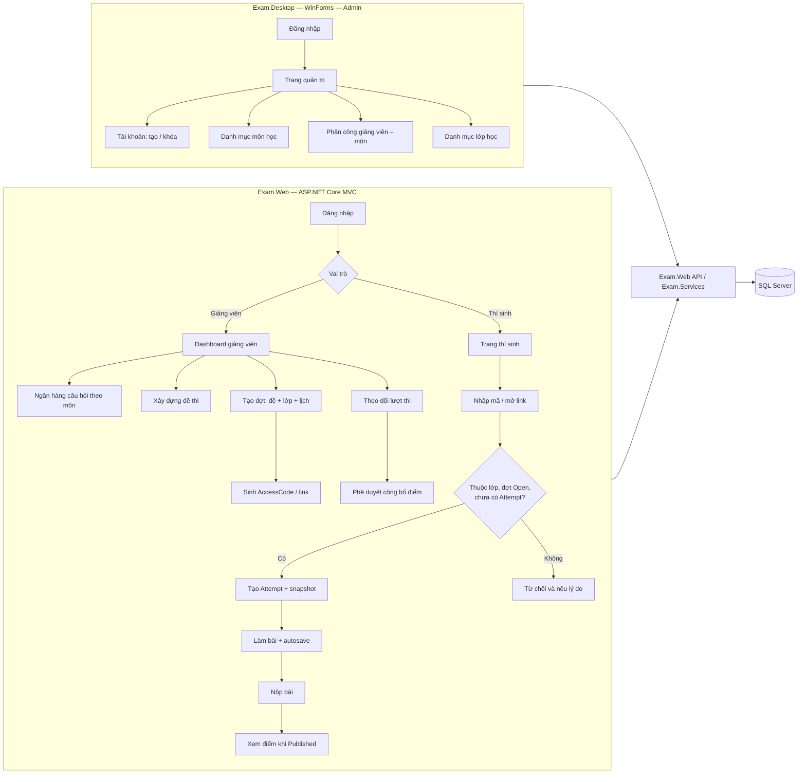
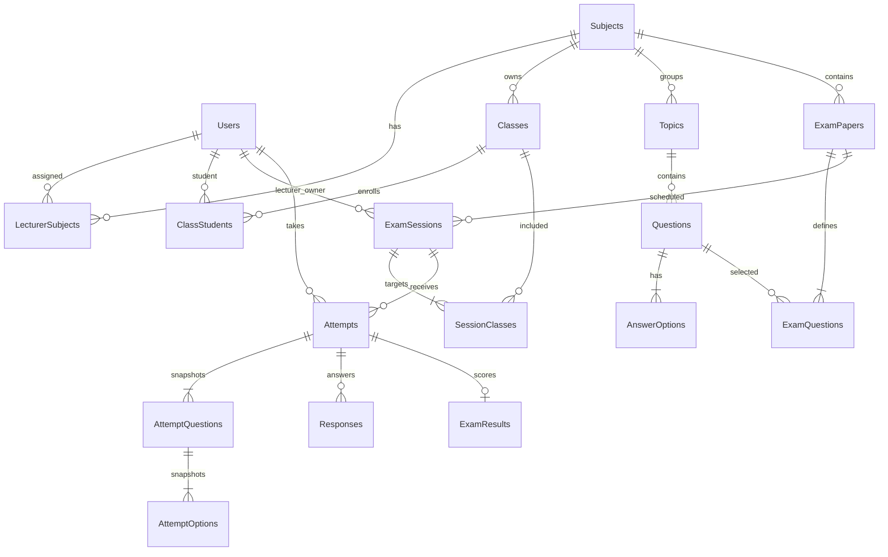

# Kiến trúc và nghiệp vụ mục tiêu — Hệ thống thi trắc nghiệm

> Tài liệu thiết kế mục tiêu theo yêu cầu ngày 10/11/2026. Chưa đồng nghĩa với code/schema hiện tại đã được chuyển đổi. Giữ mô hình hai client, một backend C# và một SQL Server dùng chung. Web theo MVC; các thao tác nghiệp vụ vẫn đi qua service để Desktop và Web không nhân đôi luật.

## 1. Phân hệ và điều hướng

Desktop chỉ có luồng Admin. Web MVC có View theo vai trò; Controller nhận request, kiểm tra model và gọi service; service thực thi authorization/nghiệp vụ; EF Core truy cập SQL Server. Web không truy vấn DB trực tiếp từ View/Controller. Desktop gọi API dùng chung.

## 2. Lược đồ dữ liệu mục tiêu

**Bảng mục tiêu:** Identity (`Users`, `Roles`, `UserRoles`, và bảng kỹ thuật cần thiết); `Subjects`, `LecturerSubjects`; `Classes`, `ClassStudents`; `Topics`, `Questions`, `AnswerOptions`; `ExamPapers`, `ExamQuestions`; `ExamSessions`, `SessionClasses`; `Attempts`, `AttemptQuestions`, `AttemptOptions`, `Responses`, `ExamResults`; `AuthSessions` nếu tiếp tục dùng thu hồi phiên.

**Thay đổi so với hiện trạng:** bỏ `SessionCandidates`; thêm `Classes`, `ClassStudents`, `SessionClasses`, `ExamSessions.AccessCode`. `ManagedBy` biểu diễn giảng viên sở hữu đợt. Không xóa cột/bảng khỏi DB đang dùng trước khi migration có sao lưu và chuyển đổi được duyệt. Không lưu mật khẩu xác nhận hay dữ liệu lớp trùng trong ExamSessions.

Khóa/ràng buộc cần có: unique `AccessCode`; unique (`SessionId`,`ClassId`); unique (`ClassId`,`StudentId`); unique (`SessionId`,`StudentId`) trên Attempts để chống tạo lượt trùng đồng thời; FK đầy đủ; mọi thêm Attempt phải transaction và kiểm tra lại quyền, lớp, thời gian, trạng thái. Nếu nhiều lớp trong một đợt có cùng sinh viên, unique Attempts vẫn bảo đảm chỉ có một lượt cho cặp đợt–thí sinh.

### Luồng vào thi và snapshot

1. Chuẩn hóa và tra `AccessCode`; từ chối nếu không tồn tại hoặc đợt không ở trạng thái Open theo cửa sổ thời gian.
2. Xác thực tài khoản Student đang hoạt động; kiểm tra tồn tại membership `ClassStudents` giao với `SessionClasses`.
3. Trong transaction, tạo Attempt duy nhất cho (`SessionId`,`StudentId`); nếu request lặp/đua đồng thời, lấy Attempt đã tạo hoặc trả thông báo phù hợp, không tạo bản thứ hai.
4. Sao chép câu hỏi, thứ tự, điểm và nội dung/phương án cần thiết vào `AttemptQuestions`/`AttemptOptions`. Lưu đáp án đúng trong snapshot phía server nhưng tuyệt đối không gửi đáp án đúng cho client trước khi được phép xem.
5. Autosave ghi `Responses` theo khóa Attempt + AttemptQuestion; nộp bài và chấm phải idempotent.

**Quyết định cần thống nhất trước khi migration:** chỉ một Attempt mỗi thí sinh/đợt phù hợp yêu cầu hiện tại. Nếu cần cho phép thi lại, phải thêm chính sách số lần và khóa tương ứng. `AccessCode` không thay thế đăng nhập; link chỉ truyền mã, không phải bí mật xác thực. Chống dò mã bằng entropy đủ lớn, giới hạn tốc độ và thông báo lỗi không tiết lộ membership.

## 3. Use case và User Story rút gọn

| Nhóm | Use cases |
|---|---|
| Admin — Desktop | UC-A01 Đăng nhập; UC-A02 Tạo/khóa tài khoản; UC-A03 Quản lý môn học; UC-A04 Phân công giảng viên phụ trách môn; UC-A05 Quản lý lớp và danh sách học viên |
| Giảng viên — Web | UC-L01 Đăng nhập; UC-L02 Quản lý câu hỏi theo môn được giao; UC-L03 Xây dựng/duyệt đề; UC-L04 Tạo, cấu hình và mở đợt thi; UC-L05 Theo dõi tiến độ; UC-L06 Phê duyệt công bố điểm |
| Thí sinh — Web | UC-S01 Đăng nhập; UC-S02 Nhập AccessCode/mở link và kiểm tra điều kiện; UC-S03 Làm bài, autosave, tiếp tục; UC-S04 Nộp bài; UC-S05 Xem điểm/kết quả đã công bố |

**User Stories:**

- Là Admin, tôi muốn tạo/khóa tài khoản và quản lý môn, lớp, phân công giảng viên để kiểm soát danh mục và quyền phụ trách.
- Là giảng viên, tôi muốn chỉ thấy môn được giao, quản lý câu hỏi và đề để tạo nội dung đúng phạm vi.
- Là giảng viên, tôi muốn tạo đợt bằng cách chọn đề, lớp và lịch; hệ thống sinh mã/link để thí sinh vào thi thuận tiện.
- Là giảng viên, tôi muốn theo dõi tiến độ và duyệt công bố để kết quả chỉ hiển thị đúng thời điểm.
- Là thí sinh, tôi muốn dùng mã/link để vào đợt hợp lệ khi mình thuộc lớp được gán.
- Là thí sinh, tôi muốn bài được autosave, snapshot không đổi trong lúc thi và chỉ xem kết quả sau công bố.

## 4. MVC, phạm vi và việc còn lại

Model: Entities/DTOs/validation; View: Razor/HTML/CSS theo vai trò; Controller: route, binding, trạng thái HTTP và gọi service. Authorization theo vai trò và đối tượng phải ở server/service; không đặt nghiệp vụ quan trọng trong View. Không mở rộng code trong lần tái cấu trúc tài liệu này.

Đối chiếu hiện trạng cho thấy code đang có `SessionCandidate`/`SessionCandidates`, chưa có `Classes`, `ClassStudents`, `SessionClasses` hoặc luồng AccessCode như thiết kế này. Vì vậy đây là thay đổi lớn về schema và quy trình. Cần cập nhật đặc tả, hợp đồng API, migration trên DB thử nghiệm, rồi kiểm tra Web/Desktop tích hợp trước khi tuyên bố hoàn tất. Tệp này là bản thiết kế tham chiếu để đồng bộ báo cáo và backlog.
