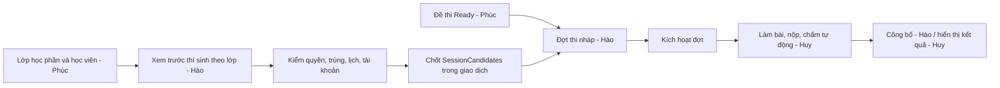

# Đề xuất quản lý lớp học

Người phụ trách: Nguyễn Hoàng Phúc. Phối hợp Bùi Nhật Hào (đợt thi), Phùng Anh Vũ (tài khoản/quyền), Trần Nhựt Huy (thi/chấm/kết quả). Ngày: 10/11/2026.

## Quyết định phân công và phạm vi đề xuất

Người dùng đã phân công Phúc phụ trách lớp và bài thi. Chi tiết quyền/schema dưới đây là đề xuất để nhóm chốt, chưa sửa code hay migration. Lớp được hiểu là **lớp học phần theo môn và học kỳ**, không phải lớp hành chính của sinh viên. Nếu cần lớp hành chính phải phân biệt hai khái niệm trước khi tạo bảng.

Quản lý lớp là một module; không mặc nhiên cần thêm role `ClassManager`. Giữ bốn vai trò hiện tại: Administrator, Lecturer, ExamOfficer, Student. Người phụ trách code khác với người có quyền dùng chức năng.

| Thao tác đề xuất | Vai trò sử dụng | Giới hạn |
|---|---|---|
| Tạo/sửa/ngừng lớp học phần, gán giảng viên, cập nhật danh sách học viên | ExamOfficer | Cán bộ được phân công quản lý lớp; xác minh giảng viên được dạy môn đó |
| Xem lớp, danh sách học viên, đề thi theo môn | Lecturer | Chỉ lớp được phân công; không tự thêm quyền hoặc sửa điểm |
| Chọn lớp và xem trước danh sách đưa vào đợt | ExamOfficer | Lớp và đợt trong phạm vi; môn lớp khớp môn đề; chỉ khi đợt còn nháp |
| Đăng nhập, duyệt nhân sự, khóa tài khoản, gán vai trò | Administrator | Vũ quản lý code; không tự suy ra quyền quản lý mọi nội dung lớp/đáp án |
| Xem đợt được giao và dự thi | Student | SessionCandidates quyết định quyền dự thi, không chỉ membership của lớp |

Nếu trường giao giảng viên tự nhập học viên, bổ sung quyền đó theo lớp được giao sau khi thống nhất. Không cho tất cả giảng viên sửa tất cả lớp.

## Hai màn hình cho một module

**Giảng viên:** tab “Lớp của tôi” → chi tiết môn/học kỳ → danh sách học viên → liên kết đề thi phù hợp môn. Phúc sở hữu module; Vũ review quyền.

**Cán bộ:** tab “Lớp học phần” để quản lý lớp; trong tab “Đợt thi” có nút “Thêm thí sinh từ lớp”. Phúc cung cấp danh sách lớp/học viên; Hào thực hiện bước xem trước/xác nhận và khóa danh sách đợt. Không duy trì hai bảng lớp khác nhau cho hai màn hình.

## Mô hình tối thiểu đề xuất

- `CourseClasses`: Id, Code (unique), Name, SubjectId, LecturerId, ManagedBy, AcademicTerm, IsActive. Một giảng viên chính/lớp ở MVP; dùng bảng nối nếu thực sự cần đồng giảng dạy.
- `ClassStudents`: ClassId, StudentId, unique(ClassId, StudentId). Dùng lại Users có role Student; không tạo tài khoản riêng cho lớp.
- Giữ `SessionCandidates` làm danh sách dự thi độc lập. Chọn một hoặc nhiều lớp để sao chép tập học viên duy nhất vào đợt; kiểm tra scope, tài khoản hoạt động, trùng lịch và môn học.
- Kiểm tra lại ở server khi xác nhận sau preview. Sau kích hoạt không tự đồng bộ thêm/xóa học viên từ lớp; chuyển lớp/ngừng lớp không xóa lượt thi, snapshot hoặc kết quả cũ.

Đây là mô hình đề xuất, chưa có các bảng CourseClasses/ClassStudents trong `Exam.Data/Entities.cs`. Không tự tạo migration trước khi thống nhất ý nghĩa lớp và quyền quản lý. Chi tiết route/DTO phải bổ sung CONTRACT.md khi triển khai, chưa đặt tên endpoint giả như endpoint đã có.

## Ranh giới giao việc

| Người | Sở hữu chức năng | Phối hợp |
|---|---|---|
| Trần Nhựt Huy | Web dự thi, lưu/nộp, thời hạn, chấm tự động trong backend, lịch sử/kết quả | Nhận đợt/danh sách từ Hào; dùng login của Vũ |
| Phùng Anh Vũ | Tài khoản của bốn vai trò, login/đăng ký, duyệt nhân sự, khóa/thu hồi phiên, phân công quyền | Huy ghép màn tài khoản vào Web; Phúc/Hào cung cấp quy tắc phạm vi |
| Nguyễn Hoàng Phúc | Lớp, danh sách học viên, chủ đề/câu hỏi, đề thi và điểm từng câu | Hào tiêu thụ danh sách lớp và đề Ready; Huy dùng snapshot để chấm |
| Bùi Nhật Hào | Môn (UC-17), đợt thi, phân công thí sinh, kích hoạt/theo dõi/công bố/xuất | Lấy dữ liệu lớp/đề từ Phúc; kết quả từ Huy |

“Bài thi” ở phần Phúc hiểu là **đề thi** (ExamPaper). “Bài làm/lượt thi” (Attempt) thuộc Huy. Chấm trắc nghiệm là nghiệp vụ server; chưa mở rộng thành màn sửa điểm thủ công. Công bố kết quả thuộc Hào, hiển thị kết quả thuộc Huy.

## Ước lượng và kiểm tra cần có

Việc D08 trong Excel dành 8 giờ khảo sát/thiết kế lớp, quyền, DTO dự kiến và ca kiểm thử. **Không phải 8 giờ hoàn thành toàn bộ tính năng lớp.** Sau chốt thiết kế, cần bổ sung task triển khai UI/API/DB và ước lượng lại; không ép công việc mới vào mức 32 giờ/người để tạo cân bằng giả.

Ca cần có khi triển khai: giảng viên ngoài lớp bị từ chối; học viên trùng hai lớp chỉ thêm một lần; học viên không hoạt động/trùng lịch bị chặn; lớp khác môn không được chọn; đổi danh sách lớp không đổi đợt đã kích hoạt; request vượt scope bị từ chối ngay tại API.
