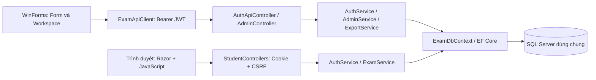
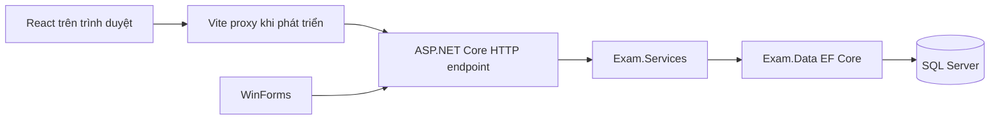

# Rà soát mã nguồn ngày 10/11/2026

Bổ sung sau phản hồi người dùng: đã cập nhật tên và phân công Huy (Web dự thi/chấm), Vũ (tài khoản), Phúc (lớp/đề), Hào (đợt). Dòng kiểm tra README ban đầu bên dưới mô tả thời điểm trước cập nhật. Kiểm tra `Exam.Data/Entities.cs` chưa thấy thực thể lớp học; thiết kế mở rộng ở `QUAN_LY_LOP_HOC.md`, chưa phải hành vi triển khai.

## Kết luận có bằng chứng

| Mục | Kết quả |
|---|---|
| Kiến trúc | Exam.Desktop WinForms; Exam.Web MVC/Razor + API; Core/Services/Data; SQL Server. App1 là lịch sử |
| React | Không tìm thấy package.json hoặc source React trong danh sách tệp repository hiện tại. Chưa biết bản React người dùng nhắc đến nằm đâu |
| Phân công | README chưa có tên bốn người; GUILD có bốn nhóm kỹ thuật. Excel mới dùng TV1–TV4 và ngày đề xuất |
| Build | `dotnet build 'Exam Management Application.slnx' --no-restore -m:1` thành công, 0 lỗi; 1 cảnh báo MSB3026 khóa apphost tạm thời |
| Unit test | Lần đầu trong sandbox bị timeout kết nối testhost 90 giây. Chạy lại ngoài sandbox với filter `FullyQualifiedName!~SqlExamTests`: 15 passed, 0 failed; chưa chạy SQL tests |
| Docker | CLI/Compose có sẵn (Compose v5.6.1), nhưng `docker info` lỗi pipe dockerDesktopLinuxEngine. Chưa chạy container |
| Compose | `docker compose -f team/docker/compose.sql.yml config --quiet` thành công với mật khẩu tạm trong process. Chỉ xác minh cấu hình, không chứng minh SQL chạy được |
| Git | Không có `.git` tại thư mục hiện tại; `git status` báo không đổi được tới thư mục cha. Chưa xác minh branch/remote, chưa commit/push |
| UI/API/DB | Lượt này chưa chạy nghiệm thu tương tác UI, HTTP hay SQL. Ảnh và báo cáo 24/10 là bằng chứng lịch sử |

## Phân biệt demo giao diện với nghiệp vụ

Source hiện có các service lưu/nộp/chấm, phân quyền, snapshot, công bố, nhập/xuất và migration. Vì vậy không nên phân công “viết lại toàn bộ backend” chỉ vì giao diện còn demo. Trước mỗi module: chạy lại luồng, ghi phần thiếu, chỉnh có mục tiêu.

## Luồng hiện tại

Ví dụ Giảng viên sửa câu hỏi: `MainForm` mở `QuestionBankView` → `ResourceView`/`ResourceEditorForm` lấy metadata và dữ liệu qua `ExamApiClient` → PUT `/api/admin/questions/{id}` với `values.version` → `AdminController.Update` → `AdminService.SaveAsync` kiểm quyền/phạm vi và version → EF ghi SQL. Version cũ trả 409; client yêu cầu tải lại. Không tạo bảng câu hỏi riêng cho từng giao diện.

Ví dụ thí sinh làm bài: `SessionsController.Start` gọi `ExamService.StartAsync` tạo/khôi phục lượt và snapshot → Razor `Attempts/Take.cshtml` cùng `attempt.js` gửi Save/Status/Submit → `ExamService` dùng giờ server và quyền sở hữu → lưu phản hồi/kết quả. Trang Result chỉ hiển thị theo chính sách công bố.

## React nằm ở đâu nếu bổ sung?

React là client JavaScript/TypeScript, ASP.NET Core là server C#, SQL Server là nơi lưu dữ liệu. Docker chỉ đóng gói/chạy tiến trình. React không kết nối cổng 1433, không chứa connection string hay SQL password.

API `/api/admin` hiện dùng JWT cho nhân sự. Các màn Web thí sinh hiện chủ yếu trả HTML Razor, không phải REST JSON đầy đủ: chỉ Status/Save/Submit có JSON theo controller đã đọc. Không trỏ React vào `/Sessions` rồi gọi `.json()` và cho rằng tích hợp đã xong. Login JWT hiện gọi `LoginAsync(request, true)`, không phải login Student. Nếu làm SPA thí sinh cần thiết kế endpoint JSON và auth/CSRF phù hợp trước; giữ Web C# theo yêu cầu môn học.

## Điểm cần control code

| Ưu tiên | Phát hiện | Tác động và việc cần làm |
|---|---|---|
| Cao | DedicatedResourceViews.cs chứa các wrapper trên cùng ResourceView; editor dùng chung | Sửa một control ảnh hưởng nhiều tab; TV1 review và chạy hồi quy mọi vai trò |
| Cao | AdminService.cs chứa nhiều resource và nhánh nghiệp vụ | Chỉ định method/resource trong ticket; nối tiếp PR chạm cùng tệp, không để bốn AI format/refactor đồng thời |
| Vừa | CatalogAsync tải users và kiểm vai trò theo vòng lặp; users list cũng gọi GetRolesAsync từng người | Nguy cơ N+1, tăng query khi dữ liệu lớn. Cần đo rồi tối ưu truy vấn có test phạm vi, chưa có số đo tải lượt này |
| Vừa | Nhiều list lấy ToListAsync trước xử lý danh sách; questions đã phân trang SQL | Không mặc định mọi resource đều phân trang ở DB; kiểm quy mô, đo rồi chuyển lọc/phân trang phù hợp |
| Vừa | Program.cs và các controller có nhiều câu lệnh trên một dòng | Khó review/bảo vệ; format/refactor riêng từng PR, tránh trộn vào sửa nghiệp vụ |

Chưa sửa nghiệp vụ hoặc đổi framework trong lượt chuẩn hóa nhóm này. Kế hoạch chia theo vai trò là đề xuất điều phối, không phải xác nhận mọi chức năng đã chạy đúng.

## Skill được yêu cầu

`C:/Users/NHUT HUY/.codex/skills/i-have-adhd/SKILL.md` đã tồn tại và đã đọc; không cài đè. Đã thử đọc AGENTS.md upstream qua GitHub/raw nhưng truy cập thất bại, nên chưa xác minh được hướng dẫn upstream. Không suy luận thông tin sức khỏe người dùng từ tên skill.
